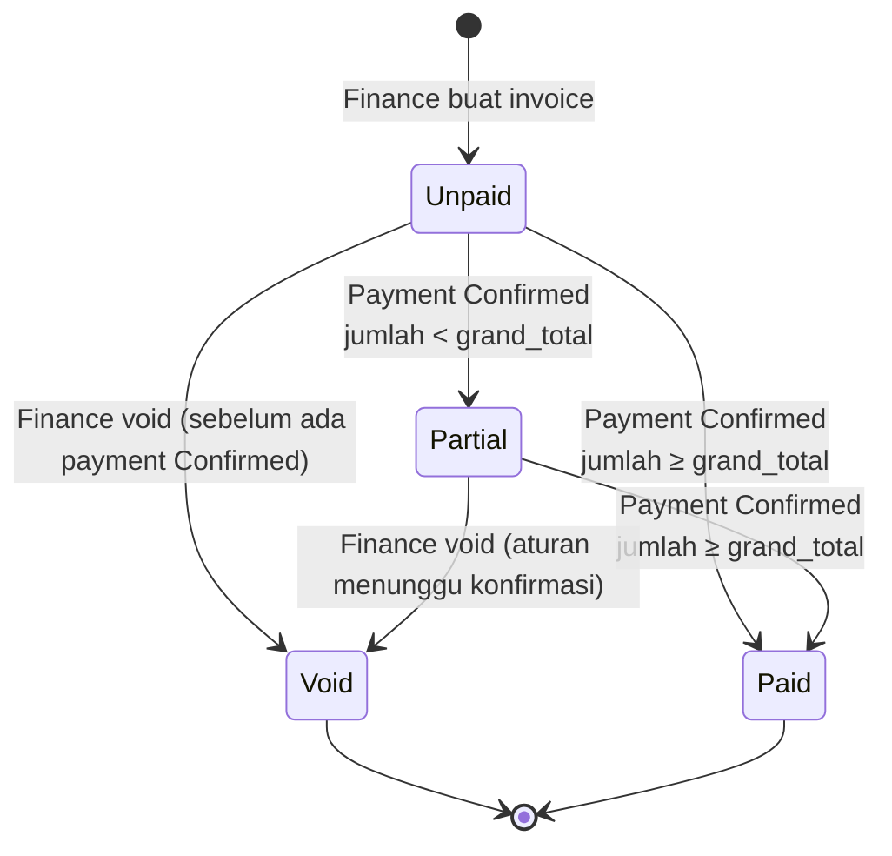
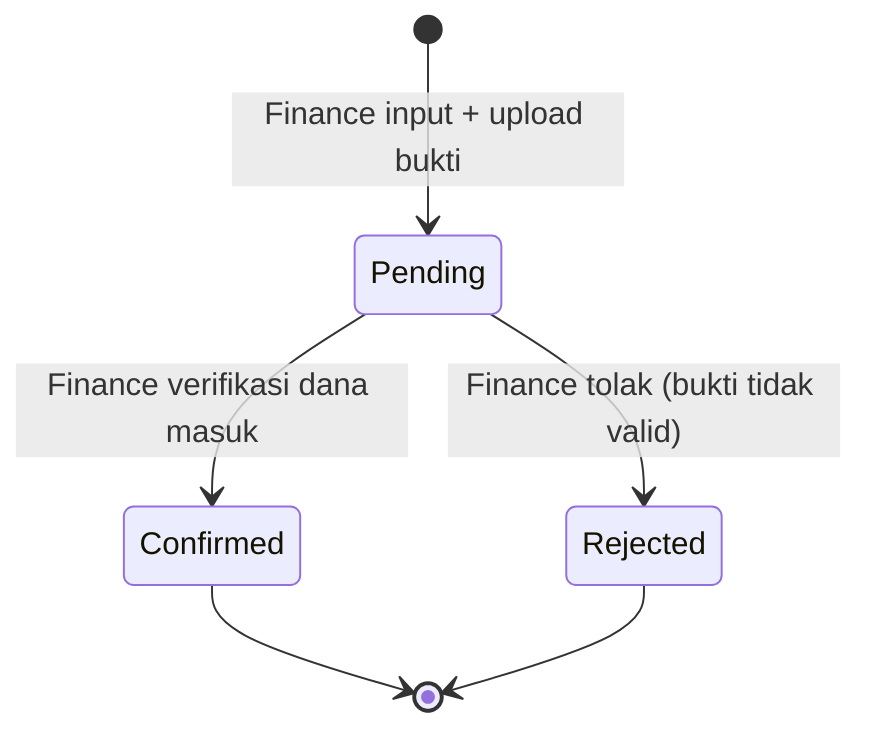

# Finance — Invoice, Payment

**Status:** Rancangan berdasarkan SRS v1.3 · **Acuan:** [full-flow.md](full-flow.md), [database.md](../database.md), [marketing.md](marketing.md)

Modul finance mencakup dua entitas: **Invoice → Payment**. Tim yang menjalankan: **Finance** (buat invoice dari termin Ready to Bill, konfirmasi payment). Sistem bertanggung jawab atas kalkulasi status, kunci tahap, dan trigger pembuatan Project saat DP lunas.

## 1. Peran & Tanggung Jawab

| Aktor | Tanggung jawab |
| --- | --- |
| Finance | Buat invoice dari termin Ready to Bill, catat payment, konfirmasi/tolak payment, void invoice bila perlu |
| Sistem | Kunci tahap Completed saat invoice dibuat; hitung status invoice (Paid/Partial) dari payment Confirmed; hitung payment status SO; trigger pembuatan Project saat DP Paid; tutup SO saat progress 100% & semua termin Paid |
| Owner | Lihat semua, override jika diperlukan |
| Marketing / Teknis | Hanya melihat invoice dan payment (read-only) |

## 2. Invoice

### 2.1 Konsep

Invoice adalah **tagihan** atas satu atau lebih termin Ready to Bill dalam satu Sales Order. Invoice tidak bisa gabung termin dari SO berbeda. Pembuatan invoice adalah operasi atomik: termin → Invoiced, tahap Completed → terkunci, semua dalam satu DB transaction (NFR-04).

### 2.2 Jenis Invoice

| Jenis | Isi | Terjadi saat |
| --- | --- | --- |
| Invoice DP | Satu termin threshold 0% | Sales Order dibuat (sebelum ada project) |
| Invoice Progress | Satu/lebih termin non-DP yang Ready to Bill | Progress project mencapai threshold |
| Invoice Pelunasan | Termin terakhir (biasanya threshold 100%) | Pekerjaan selesai |

Tiga jenis di atas adalah **cara pakai**, bukan status terpisah di `ms_status`. Semua memakai status `invoice` yang sama.

### 2.3 Alur Status



**Catatan:**

- `Overdue` **bukan** status tersimpan; hasil perhitungan `due_date < now() AND status IN (unpaid, partial)`.
- Invoice tidak dapat diedit setelah ada payment (BR-11).
- Void mengembalikan termin ke Ready to Bill (BR-09).

### 2.4 Daftar Status Invoice (tipe `invoice`)

| Code | Nama | Keterangan |
| --- | --- | --- |
| `unpaid` | Unpaid | Belum ada pembayaran yang dihitung |
| `partial` | Partial | Sudah dibayar sebagian |
| `paid` | Paid | Total payment Confirmed ≥ grand_total |
| `void` | Void | Dibatalkan; termin kembali Ready to Bill |

### 2.5 Field Invoice Header (`trans_sales_invoice_hd`)

| Field | Tipe | Null | Keterangan |
| --- | --- | --- | --- |
| `code` | varchar(50) | tidak | Format `INV/YY/MM/0001` |
| `transaction_date` | date | tidak | Tanggal invoice |
| `order_hd_id` | FK `trans_sales_order_hd` | tidak | SO sumber (wajib) |
| `project_hd_id` | FK `trans_project_hd` | **ya** | **Nullable** untuk invoice DP (project belum ada) |
| `quotation_hd_id` | FK `trans_sales_quotation_hd` | tidak | Untuk referensi; disalin dari SO |
| `client_id` | FK | tidak | Disalin dari SO |
| `company_id` | FK | tidak | Disalin dari SO |
| `bank_account_id` | FK `ms_bank_account` | tidak | Rekening penerima |
| `due_date` | date | tidak | Jatuh tempo |
| `subtotal` | decimal(20,6) | tidak | Σ amount termin yang ditagih |
| `vat_type` | varchar(50) | tidak | Disalin dari SO |
| `vat_amount` | decimal(20,6) | tidak | Dihitung dari subtotal + vat_type |
| `grand_total` | decimal(20,6) | tidak | subtotal + vat_amount |
| `notes` | text | ya | Catatan |
| `status_id` | FK status tipe `invoice` | tidak | Default `unpaid` |

### 2.6 Detail Invoice (`trans_sales_invoice_dt`)

| Field | Tipe | Keterangan |
| --- | --- | --- |
| `invoice_hd_id` | FK | Header |
| `sales_term_id` | FK `trans_sales_term` | Termin yang ditagih |
| `sequence` | integer | Urutan baris |
| `description` | text | Keterangan tambahan (opsional) |
| `percentage` | integer | Snapshot `percentage` termin |
| `amount` | decimal(20,6) | Snapshot `amount` termin |

**Constraint parsial:** satu `sales_term_id` tidak boleh muncul di **invoice aktif** lain. "Aktif" = status invoice bukan `void`. Karena constraint parsial sulit di-enforce via DB di MySQL/MariaDB, validasi dilakukan di service `CreateInvoiceFromTermsService` dengan `lockForUpdate()`.

### 2.7 Service: `CreateInvoiceFromTermsService`

**Trigger:** Finance pilih satu atau lebih termin Ready to Bill dari satu SO, klik "Buat Invoice".

**Langkah dalam satu `DB::transaction` (NFR-04):**

1. **Guard order id sama:** semua termin yang dipilih harus milik `order_hd_id` yang sama. Jika tidak, lempar `DomainException`.
2. **Guard status termin:** semua termin status `ready_to_bill`. Lock baris dengan `lockForUpdate()`.
3. **Guard termin bebas invoice aktif:** cek `trans_sales_invoice_dt` yang `sales_term_id = ?` dan join ke invoice yang status ≠ `void`. Jika ada, lempar `DomainException`.
4. **Buat invoice HD:** generate `code`, hitung subtotal/vat/grand_total dari termin. `project_hd_id` boleh null (untuk invoice DP).
5. **Buat invoice DT:** satu baris per termin, snapshot `percentage` dan `amount`.
6. **Update termin:** status → `invoiced`.
7. **Kunci tahap Completed:** jika invoice memiliki `project_hd_id`, update semua `trans_project_dt` dengan `status = completed` menjadi `editable = false` (BR-05).
8. **Catat ke project monitoring:** satu log per tahap yang terkunci (opsional, mengikuti BR-10).

**Setelah commit (di luar transaction):**

- Email ke Finance dan PIC/Teknis (opsional) tentang pembuatan invoice.
- Trigger ulang kalkulasi `payment_status` SO (seharusnya masih Unpaid).

### 2.8 Service: `VoidInvoiceService`

**Trigger:** Action `Void` di invoice resource; visible saat `status ∈ {unpaid, partial}`.

**Langkah dalam satu DB transaction:**

1. **Guard:** cek apakah ada payment Confirmed. Jika ada, lempar `DomainException` (atau aturan menyusul — belum final di SRS).
2. **Update invoice:** `status = void`.
3. **Kembalikan termin:** semua termin di invoice ini → `status = ready_to_bill`.
4. **Unlock tahap:** untuk tiap tahap yang di-lock karena invoice ini, cek apakah masih ada invoice aktif lain yang mencakup termin yang mengunci tahap. Jika tidak ada, set `editable = true` (BR-09).
5. **Log monitoring (BR-10):** append log baru untuk tiap tahap yang berubah.

### 2.9 Overdue Highlight

Overdue dihitung di query, bukan status. Pattern di Filament table:

```php
TextColumn::make('due_date')
    ->label('Jatuh Tempo')
    ->date('d M Y')
    ->color(fn ($record) => $record->due_date->isPast() && in_array($record->status->code, ['unpaid', 'partial'])
        ? 'danger'
        : null
    );
```

## 3. Payment

### 3.1 Konsep

Payment adalah **catatan pembayaran** atas invoice. Satu invoice bisa punya banyak payment (cicilan). Hanya payment berstatus **Confirmed** yang dihitung ke pelunasan. Payment Pending/Rejected tidak mengurangi sisa tagihan.

### 3.2 Alur Status



**Catatan:** Payment Confirmed/Rejected tidak dapat diubah lagi — jika salah, buat payment baru atau koreksi lewat `ReversePaymentService` (belum ada, perlu CR).

### 3.3 Daftar Status Payment (tipe `payment`)

| Code | Nama | Keterangan |
| --- | --- | --- |
| `pending` | Pending | Bukti transfer diunggah, belum diverifikasi |
| `confirmed` | Confirmed | Finance pastikan dana masuk; dihitung ke invoice |
| `rejected` | Rejected | Ditolak; tidak dihitung |

### 3.4 Field Payment (`trans_sales_payment`)

| Field | Tipe | Null | Keterangan |
| --- | --- | --- | --- |
| `code` | varchar(50) | tidak | Format `PAY/YY/MM/0001` |
| `transaction_date` | date | tidak | Tanggal transfer / cash |
| `invoice_hd_id` | FK `trans_sales_invoice_hd` | tidak | Invoice yang dibayar |
| `amount` | decimal(20,6) | tidak | Nominal pembayaran |
| `payment_method` | varchar(128) | tidak | Enum: `cash`, `transfer`, `giro`, dll. (perlu enum PHP `PaymentMethod`) |
| `reference_no` | varchar(50) | ya | Nomor referensi/transaksi bank; null untuk cash |
| `payment_proof` | varchar(255) | ya | Path file bukti transfer (disk `public`) |
| `notes` | text | ya | Catatan |
| `status_id` | FK status tipe `payment` | tidak | Default `pending` |

### 3.5 Service: `RecordPaymentService`

**Trigger:** Finance input payment dari relation manager invoice.

**Langkah:**

1. **Guard invoice:** status invoice ∈ `{unpaid, partial}`. Invoice `void` atau `paid` tidak dapat menerima payment baru.
2. **Guard amount:** `amount > 0` dan `amount ≤ sisa_tagihan` (opsional — bisa diperbolehkan lebih untuk kelebihan bayar; aturan belum final).
3. **Buat payment:** generate `code`, status default `pending`.
4. **Simpan file bukti:** upload ke `payments/proof` di disk public.

### 3.6 Service: `ConfirmPaymentService`

**Trigger:** Action `Confirm` di payment resource; visible saat `status = pending`.

**Langkah dalam DB transaction:**

1. **Guard:** payment status = `pending`.
2. **Update payment:** `status = confirmed`.
3. **Hitung ulang invoice:**
   - `total_confirmed = Σ amount payment status=confirmed` di invoice.
   - Jika `total_confirmed ≥ grand_total` → invoice status = `paid`, semua termin invoice ini → `paid`.
   - Jika `0 < total_confirmed < grand_total` → invoice status = `partial`.
4. **Hitung ulang payment status SO:**
   - Ambil semua termin aktif SO (bukan Draft).
   - `total_terms_paid = count(status = paid)`.
   - Jika `total_terms_paid = 0` → `unpaid`.
   - Jika `0 < total_terms_paid < total_terms_count` → `partial`.
   - Jika semua Paid → `paid`.
5. **Trigger pembuatan Project (BR-15):**
   - Jika SO status = `waiting_dp` dan invoice ini mengandung termin DP (threshold 0%) dan sekarang Paid → panggil `CreateProjectFromSalesOrderService`. Setelah project dibuat, SO status → `on_progress`.
6. **Trigger penutupan SO (BR-13):**
   - Jika SO sudah punya Project, cek `progress_percentage = 100` dan `payment_status = paid` → SO status = `closed`. Project status = `completed` jika belum.

**Setelah commit:**

- Jika Project baru saja dibuat → email ke Teknis + PIC (satu kali, BR-15).

### 3.7 Service: `RejectPaymentService`

**Trigger:** Action `Reject` di payment resource; visible saat `status = pending`.

**Langkah:**

1. **Update payment:** `status = rejected`.
2. **Tidak ada perubahan invoice/SO** karena payment Rejected tidak dihitung.

## 4. Dashboard Finance (FR-41)

Widget khusus Finance di dashboard:

| Widget | Query |
| --- | --- |
| Termin Ready to Bill | `TransSalesTerm::where('status', 'ready_to_bill')->count()` |
| Invoice Outstanding | `TransSalesInvoiceHd::whereIn('status', ['unpaid', 'partial'])->count()` |
| Total Outstanding | `Σ (grand_total − Σ payment confirmed)` dari invoice outstanding |
| Overdue | `TransSalesInvoiceHd::whereIn('status', ['unpaid', 'partial'])->where('due_date', '<', now())->count()` |
| Revenue Bulan Ini | `Σ amount payment confirmed di bulan ini` |

Chart tambahan:

- Payment per Bulan (bar chart) — 12 bulan terakhir.
- Invoice per Status (doughnut) — distribusi status.

## 5. Resource Filament yang Dibutuhkan

| Resource | Group | Keterangan |
| --- | --- | --- |
| `TransSalesInvoiceHdResource` | Keuangan | List + Create + View + Edit terbatas. Relation manager untuk detail dan payment. Custom action: Void, Print PDF. |
| `TransSalesPaymentResource` | Keuangan | List + Create + View. Custom action: Confirm, Reject. |

### 5.1 Pembuatan Invoice via Custom Page

Pembuatan invoice **tidak** cukup lewat form standar — Finance harus pilih termin dulu. Ada dua opsi UI:

**Opsi A — Custom Page:**

- Dari resource SO view page, action `Buat Invoice` → page khusus.
- Page menampilkan daftar termin Ready to Bill SO; Finance centang yang mau ditagih.
- Submit → panggil `CreateInvoiceFromTermsService`.

**Opsi B — Form multi-step:**

- Create page invoice dengan step pertama memilih SO, step kedua memilih termin.
- Lebih umum di Filament; implementasi dengan `Wizard` component.

Rekomendasi: **Opsi A** karena alur Finance lebih natural (dari SO yang sudah dicari, bukan dari form invoice kosong).

### 5.2 Custom Action di Payment

- `ConfirmAction` — visible saat `status = pending`; `requiresConfirmation`.
- `RejectAction` — visible saat `status = pending`; wajib isi alasan di modal.

## 6. Catatan Transaksional

### 6.1 NFR-04 — Konsistensi

Operasi berikut **wajib** dalam satu `DB::transaction`:

1. Pembuatan invoice: insert HD + insert DT + update termin + lock tahap.
2. Confirm payment: update payment + hitung invoice + hitung SO payment_status + (jika DP) buat Project.
3. Void invoice: update invoice + kembalikan termin + unlock tahap (sesuai kondisi).

### 6.2 Race condition pada pembuatan invoice bersamaan

Dua user Finance klik "Buat Invoice" dari termin yang sama di waktu bersamaan. Pencegahan:

```php
$terms = TransSalesTerm::whereIn('id', $termIds)
    ->where('status_id', $readyToBillStatusId)
    ->lockForUpdate()  // SELECT ... FOR UPDATE
    ->get();
```

Jika row sudah dikunci user lain, request kedua antre; saat dapat giliran, status termin sudah `invoiced` → service lempar `DomainException`.

### 6.3 Payment status SO perlu di-recompute, bukan increment

Saat payment confirmed/rejected/voided, jangan simpan counter manual di SO. Hitung ulang dari sumber:

```php
$totalTerms = $order->terms()->count();
$paidTerms = $order->terms()->whereRelation('status', 'code', 'paid')->count();

$paymentStatus = match (true) {
    $paidTerms === 0 => 'unpaid',
    $paidTerms < $totalTerms => 'partial',
    default => 'paid',
};
```

## 7. Checklist Implementasi (Finance)

- [ ] Migration `trans_sales_invoice_hd` + `trans_sales_invoice_dt`.
- [ ] Migration `trans_sales_payment`.
- [ ] Model Eloquent: `TransSalesInvoiceHd/Dt`, `TransSalesPayment`.
- [ ] Enum PHP: `PaymentMethod` (`cash`, `transfer`, `giro`).
- [ ] Tambah case di `AutoCodePrefix`: `TransSalesInvoiceHd = 'INV'`, `TransSalesPayment = 'PAY'` (ganti value lama jika perlu).
- [ ] Service: `CreateInvoiceFromTermsService`, `VoidInvoiceService`, `RecordPaymentService`, `ConfirmPaymentService`, `RejectPaymentService`.
- [ ] Resource Filament + relation manager + custom action.
- [ ] Custom page/wizard untuk pembuatan invoice dari termin Ready to Bill.
- [ ] Notification: `InvoiceCreatedNotification` (opsional ke client/Finance), `FirstTermPaidNotification` (ke Teknis + PIC saat DP Paid).
- [ ] Dashboard Finance widget.
- [ ] Scheduler: notifikasi invoice H-3 jatuh tempo (opsional).
- [ ] Test unit untuk service: pembuatan invoice, confirm payment memicu pembuatan Project (DP case), void invoice membuka kunci tahap, SO Closed saat semua termin Paid.
