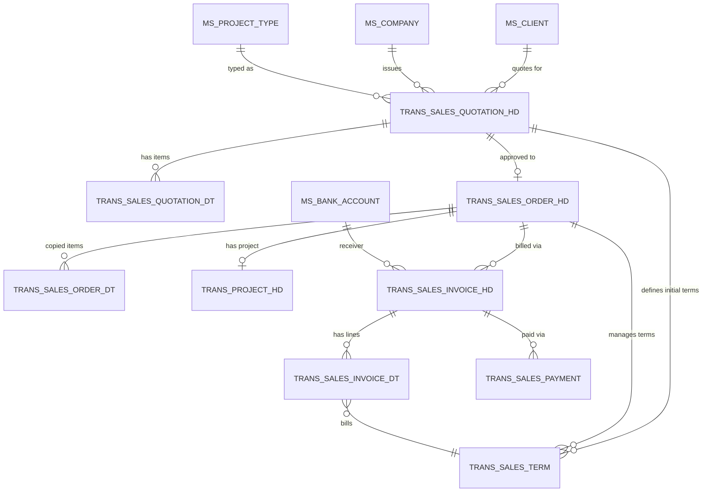

# Full Flow Bisnis Sanitra — Modul Sales

**Status:** Rancangan berdasarkan SRS v1.3 (11 Oktober 2026) · **Acuan:** [SRS v1.3](https://drive.google.com/file/d/1UPHenlYyMfJjUuIgG9wFn3pJP2gAAPq0/view), [database.md](../database.md) · **Terkait:** [marketing.md](marketing.md), [finance.md](finance.md)

Dokumen ini menyatukan alur bisnis modul sales dari pengajuan penawaran sampai pelunasan. Modul sales mencakup lima entitas transaksi: **Quotation → Sales Order → Term → Invoice → Payment**. Project muncul sebagai anak Sales Order dan dirinci di dokumen tersendiri.

## 1. Konsep Umum

### 1.1 Perubahan dari SRS v1.0

SRS v1.3 menambahkan entitas **Sales Order (SO)** sebagai jembatan antara Quotation dan Project. Konsekuensinya:

- Quotation hanya untuk negosiasi; begitu Approved, data finansial dan item disalin ke Sales Order dan tidak dapat diubah lagi dari Quotation.
- Termin yang semula hanya di quotation sekarang **dikelola dari Sales Order** setelah Approved. Satu baris termin dapat tetap dipakai, dengan tambahan FK `order_hd_id`.
- Invoice dan Project **selalu berasal dari Sales Order**, bukan langsung dari Quotation.
- Project baru dibuat setelah DP (termin pertama dengan threshold 0%) lunas; jika tidak ada DP, Project dibuat bersamaan dengan Sales Order.

### 1.2 Entitas Utama Modul Sales

| Entitas | Tabel | Peran |
| --- | --- | --- |
| Quotation | `trans_sales_quotation_hd` + `trans_sales_quotation_dt` | Penawaran harga; negosiasi dengan client |
| Sales Order (SO) | `trans_sales_order_hd` + `trans_sales_order_dt` | Kontrak penjualan; snapshot item dan nilai |
| Term | `trans_sales_term` | Skema termin: persentase, threshold, nilai dikunci |
| Invoice | `trans_sales_invoice_hd` + `trans_sales_invoice_dt` | Tagihan atas satu atau lebih termin |
| Payment | `trans_sales_payment` | Pembayaran atas invoice |

Project (`trans_project_hd/dt/monitoring`) adalah entitas anak Sales Order, dibahas pada dokumen project tersendiri.

## 2. Flowchart Alur Bisnis

```mermaid
flowchart TD
    Start([Mulai: Kebutuhan Client]) --> QDraft[Marketing buat Quotation Draft]
    QDraft --> QSent[Marketing kirim ke Client - Status Sent]
    QSent --> Respon{Respon Client}
    Respon -->|Approved| GenSO[Sistem generate Sales Order<br/>- Copy HD + DT dari Quotation<br/>- Bind termin ke order_hd_id<br/>- Status SO: Waiting DP / On Progress]
    Respon -->|Rejected| EndRej([END - Rejected])
    Respon -->|Revisi| QDraft

    GenSO --> AdaDP{Ada termin<br/>threshold 0%?<br/>DP}

    AdaDP -->|Ya| DPReady[Termin DP otomatis Ready to Bill<br/>Email ke Finance]
    DPReady --> DPInv[Finance buat Invoice DP]
    DPInv --> DPPay[Finance catat & konfirmasi Payment]
    DPPay --> DPCheck{Invoice DP Paid?}
    DPCheck -->|Belum| DPPay
    DPCheck -->|Ya| GenProj

    AdaDP -->|Tidak| GenProj[Sistem generate Project<br/>- Status Project: Open<br/>- Status SO: On Progress<br/>Email ke Teknis + PIC]

    GenProj --> GenStage[Sistem copy workflow jadi Tahap<br/>Status tahap: Draft]
    GenStage --> UpdStage[Teknis update status tahap<br/>Draft → On Progress → Completed]
    UpdStage --> HitProg[Sistem hitung progress<br/>= Σ bobot tahap Completed]
    HitProg --> CekThr{Progress ≥<br/>threshold termin<br/>belum ditagih?}
    CekThr -->|Belum| UpdStage
    CekThr -->|Ya| TrmReady[Termin Ready to Bill<br/>Email ke Finance]
    TrmReady --> InvGen[Finance buat Invoice<br/>Tahap Completed terkunci]
    InvGen --> InvPay[Finance catat & konfirmasi Payment]
    InvPay --> InvCheck{Invoice Paid?}
    InvCheck -->|Belum| InvPay
    InvCheck -->|Ya| CloseCheck{Progress 100% &<br/>semua termin Paid?}
    CloseCheck -->|Belum| UpdStage
    CloseCheck -->|Ya| SOClosed[Sales Order Closed]
    SOClosed --> EndOk([END - Closed])
```



## 3. Business Rules

Nomor BR mengikuti SRS v1.3 bagian 5. Rule ini wajib dijaga lintas layer (form validation, service, database constraint).

### 3.1 Nilai & Perhitungan

| Kode | Aturan |
| --- | --- |
| **BR-01** | Total persentase termin satu quotation = 100%. Persentase dan threshold berupa bilangan bulat. |
| **BR-02** | `amount` termin = persentase × grand total quotation. Dihitung dan **dikunci saat Sales Order dibuat** (quotation Approved); tidak berubah sesudahnya. |
| **BR-03** | Total bobot tahap per tipe project = 100. Progress project = jumlah bobot tahap berstatus Completed. |

### 3.2 Termin & Invoice

| Kode | Aturan |
| --- | --- |
| **BR-04** | Termin Ready to Bill saat `progress ≥ threshold` dan termin belum berada di invoice aktif. Dicek saat SO dibuat, Project dibuat, dan tiap progress berubah. Termin threshold 0% = DP (tanpa syarat urutan). |
| **BR-05** | Saat invoice dibuat, semua tahap Completed project terkunci (`editable = false`). Kunci berlaku selama project punya invoice aktif yang menguncinya. |
| **BR-06** | Sejak termin pertama ditagih, tahap tidak dapat ditambah, dihapus, atau diubah bobotnya. |
| **BR-09** | Void invoice mengembalikan termin ke Ready to Bill. Jika masih ada invoice aktif lain, tahap tetap terkunci; jika tidak, kunci dibuka. Invoice belum dibayar tetap Unpaid/Overdue, bukan otomatis Void. |

### 3.3 Edit & Revisi

| Kode | Aturan |
| --- | --- |
| **BR-07** | Tahap terkunci hanya dapat diubah oleh role dengan izin override, wajib alasan, dan tercatat sebagai log override. |
| **BR-08** | Pekerjaan ulang setelah tahap ditagih dicatat sebagai log rework **tanpa mengubah progress**. |
| **BR-10** | Log monitoring append-only — tidak dapat diedit atau dihapus. Koreksi dibuat sebagai log baru. |
| **BR-11** | Quotation hanya dapat diedit saat Draft. Invoice hanya dapat diedit sebelum ada pembayaran. |
| **BR-12** | Revisi quotation = kembalikan status Sent → Draft. Histori status tetap tercatat; **tidak ada nomor revisi atau versi terpisah**. |

### 3.4 Sales Order & Flow Lintas Entitas

| Kode | Aturan |
| --- | --- |
| **BR-13** | Sales Order Closed hanya jika progress project 100% dan **semua** termin Paid. |
| **BR-14** | Format nomor dokumen, tarif PPN, dan format PDF mengikuti contoh Sanitra. |
| **BR-15** | Jika ada DP (threshold 0%), Project baru dibuat setelah invoice DP berstatus Paid (hanya payment Confirmed yang dihitung). Setelah project dibuat, sistem kirim satu email ke Teknis dan PIC. Jika tidak ada DP, Project dibuat bersamaan dengan Sales Order. |
| **BR-16** | Termin disusun di Quotation. Setelah Quotation Approved, termin **dikelola dari Sales Order** dan tidak dapat diubah dari Quotation. |
| **BR-17** | Pembuatan Sales Order (termasuk penyalinan item dan pengikatan termin) berjalan dalam satu transaksi database. **Satu Quotation → satu Sales Order → satu Project.** |

## 4. Status & Transisi

Status disimpan di `ms_status` per `type`. SRS v1.3 memakai **31 status** untuk 8 tipe entitas. Daftar lengkap ada di [database.md §4.12](../database.md) dan [marketing.md](marketing.md)/[finance.md](finance.md).

### 4.1 Ringkasan transisi lintas entitas

| Entitas | Status | Pindah ke | Pemicu |
| --- | --- | --- | --- |
| Quotation | Draft | Sent | Marketing kirim ke client |
| Quotation | Sent | Approved / Rejected / Draft | Respon client; revisi balik ke Draft |
| Sales Order | — | Waiting DP / On Progress | Quotation Approved — Waiting DP jika ada DP, On Progress jika tanpa DP |
| Sales Order | Waiting DP | On Progress | Invoice DP Paid; Project dibuat |
| Sales Order | On Progress | Closed | Progress 100% + semua termin Paid |
| Payment SO | Unpaid | Partial → Paid | Diperbarui otomatis dari invoice & payment Confirmed |
| Project | Open | On Progress | Tahap pertama dimulai |
| Project | On Progress | Completed | Progress 100% (otomatis) |
| Tahap | Belum Dimulai/Sedang Dikerjakan | Selesai / Terkendala | Teknis update; Terkendala (`blocked`) wajib notes |
| Tahap | Completed | On Progress | Hanya jika belum terkunci, wajib alasan |
| Termin | Draft | Pending | Quotation Approved, SO dibuat |
| Termin | Pending | Ready to Bill | Progress ≥ threshold |
| Termin | Ready to Bill | Invoiced | Invoice dibuat |
| Termin | Invoiced | Paid / Ready to Bill | Invoice lunas / invoice di-void |
| Invoice | Unpaid | Partial → Paid | Payment Confirmed terhitung |
| Invoice | Unpaid | Void | Dibatalkan Finance |
| Payment | Pending | Confirmed / Rejected | Finance verifikasi |

**Catatan:**

- `Overdue` adalah hasil perhitungan (bukan status tersimpan): invoice Unpaid/Partial yang due_date lewat.
- Payment Pending/Rejected **tidak** mengurangi sisa tagihan.
- Status `Cancelled` pada SO dan Project perlu konfirmasi aturan pembatalan ke Sanitra.

## 5. ERD Overview — Modul Sales



### 5.1 Relasi Kunci

| Dari | Ke | Kardinalitas | Keterangan |
| --- | --- | --- | --- |
| `trans_sales_quotation_hd` | `trans_sales_order_hd` | 1 : 0..1 | Satu quotation Approved → satu SO. FK `trans_sales_order_hd.quotation_hd_id` **unique**. |
| `trans_sales_order_hd` | `trans_project_hd` | 1 : 0..1 | Satu SO → satu Project. FK `trans_project_hd.order_hd_id` **unique**. |
| `trans_sales_order_hd` | `trans_sales_term` | 1 : N | Termin dikelola di SO setelah Approved. FK `trans_sales_term.order_hd_id` di-set saat SO dibuat (nullable awalnya). |
| `trans_sales_quotation_hd` | `trans_sales_term` | 1 : N | Termin disusun di Quotation. FK `trans_sales_term.quotation_hd_id` wajib. |
| `trans_sales_order_hd` | `trans_sales_invoice_hd` | 1 : N | Invoice selalu dari SO. FK `trans_sales_invoice_hd.order_hd_id` wajib. |
| `trans_project_hd` | `trans_sales_invoice_hd` | 1 : N | Invoice terhubung ke project. FK `trans_sales_invoice_hd.project_hd_id` **nullable** (invoice DP dibuat sebelum project ada). |
| `trans_sales_invoice_hd` | `trans_sales_invoice_dt` | 1 : N | Baris invoice merujuk termin. |
| `trans_sales_invoice_dt` | `trans_sales_term` | N : 1 | Satu termin boleh masuk hanya **satu invoice aktif**. |
| `trans_sales_invoice_hd` | `trans_sales_payment` | 1 : N | Pembayaran terhadap invoice. |

### 5.2 Keterikatan one-to-one yang perlu dijaga

Tiga pasangan one-to-one memerlukan unique constraint di database:

- `trans_sales_order_hd.quotation_hd_id` → unique
- `trans_project_hd.order_hd_id` → unique
- `trans_sales_invoice_dt(quotation_term_id)` ketika invoice bukan Void → unique parsial, divalidasi di aplikasi (lihat BR-09)

## 6. Alur Service (Rangkum)

Rincian service ada di [marketing.md](marketing.md) dan [finance.md](finance.md). Daftar singkat untuk modul sales:

| Service | Lokasi | Fungsi |
| --- | --- | --- |
| `SendQuotationService` | `Services/Quotation/` | Validasi total termin 100%, Draft → Sent |
| `ApproveQuotationService` | `Services/Quotation/` | Sent → Approved → trigger `CreateSalesOrderFromQuotationService` |
| `RejectQuotationService` | `Services/Quotation/` | Sent → Rejected |
| `ReviseQuotationService` | `Services/Quotation/` | Sent → Draft (histori tercatat) |
| `CreateSalesOrderFromQuotationService` | `Services/SalesOrder/` | Copy HD/DT, bind termin, set status SO (Waiting DP / On Progress); dalam satu DB transaction |
| `CreateProjectFromSalesOrderService` | `Services/Project/` | Dipanggil setelah DP Paid atau saat SO dibuat tanpa DP |
| `CreateInvoiceFromTermsService` | `Services/Invoice/` | Buat invoice dari termin Ready to Bill satu SO; kunci tahap Completed |
| `VoidInvoiceService` | `Services/Invoice/` | Invoice → Void; kembalikan termin; buka kunci tahap kalau tidak ada invoice aktif |
| `RecordPaymentService` | `Services/Payment/` | Simpan payment; `ConfirmPaymentService` jalan setelahnya |
| `ConfirmPaymentService` | `Services/Payment/` | Payment → Confirmed → hitung ulang invoice & SO payment status → trigger pembuatan Project (jika DP) atau penutupan SO |

Semua service memakai pola `DB::transaction` + notification di luar transaction, sesuai konvensi di [filament-lifecycle-hook.md](../filament-lifecycle-hook.md).

## 7. Dependensi antar Modul

```
Quotation (marketing.md) ──Approved──► Sales Order (marketing.md)
                                             │
                                             ├─► Term (marketing.md) ──Ready to Bill──► Invoice (finance.md)
                                             │                                               │
                                             │                                               └─► Payment (finance.md)
                                             │
                                             └─► Project (project.md — belum ditulis)
```

- **marketing.md**: Quotation + Sales Order + Term — tanggung jawab tim Marketing + Sistem.
- **finance.md**: Invoice + Payment — tanggung jawab tim Finance.
- **project.md** (belum ditulis): detail tahap, workflow, monitoring, override — tanggung jawab tim Teknis.

## 8. Prasyarat Implementasi

Sebelum mulai migration dan resource modul sales, pastikan:

1. ✅ Master data lengkap (`ms_client`, `ms_item`, `ms_project_type`, `ms_project_workflow`, `ms_bank_account`, `ms_status`).
2. ⚠ Status `ms_status` perlu di-reseed dari 25 ke **31** sesuai SRS v1.3 (enum PHP di `app/Enums/Status/*` juga perlu update).
3. ⚠ Enum `AutoCodePrefix` perlu tambahan prefix: `SO` untuk sales order (atau `ORD`). Prefix `QUO`, `INV`, `PAY` tetap.
4. ⚠ Tabel transaksi lama (`trans_quotation_*`, `trans_invoice_*`, `trans_payment`) belum dibuat migrationnya — langsung pakai nama baru `trans_sales_*`.
5. ⚠ Alias polymorphic `ms_document` untuk `order` dan `project` dapat ditambahkan jika dokumen diperlukan di dua entitas tersebut.

## 9. Catatan untuk Change Request

Hal yang **belum** tercakup SRS v1.3 dan harus diajukan sebagai CR:

- Pembatalan Sales Order di tengah proses (status `Cancelled`): aturan refund, pembatalan invoice/payment yang sudah ada.
- Perubahan item di Sales Order setelah Approved (saat ini tidak diperbolehkan).
- Multiple project per Sales Order.
- Partial fulfillment (SO terpenuhi sebagian).
