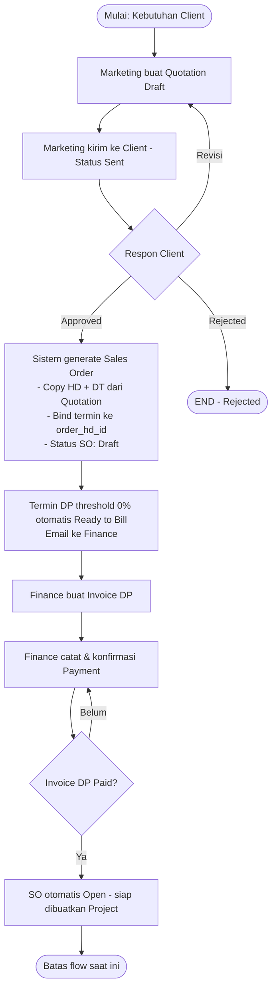
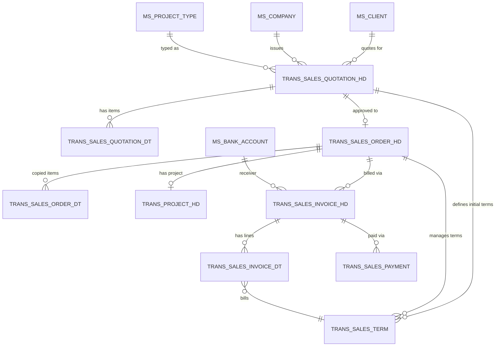

# Business Flow — Full Flow Modul Sales

**Status:** Rancangan berdasarkan SRS v1.3 dan keputusan implementasi terbaru (11 Oktober 2026) · **Acuan:** [SRS v1.3](https://drive.google.com/file/d/1UPHenlYyMfJjUuIgG9wFn3pJP2gAAPq0/view), [database.md](../database.md) · **Modul:** [quotation.md](quotation.md), [sales-order-term.md](sales-order-term.md), [invoice.md](invoice.md), [payment.md](payment.md)

Dokumen ini adalah peta/overview modul sales. Flow yang sudah dikerjakan saat ini berakhir ketika SO menjadi `open` dan siap dibuatkan Project. Proses setelah Project dibuat masih tahap berikutnya; rincian rancangan lanjutannya ditandai terpisah di dokumen modul.

## 1. Konsep Umum

### 1.1 Perubahan dari SRS v1.0

SRS v1.3 menambahkan entitas **Sales Order (SO)** sebagai jembatan antara Quotation dan Project. Konsekuensinya:

- Quotation hanya untuk negosiasi; begitu Approved, data finansial dan item disalin ke Sales Order dan tidak dapat diubah lagi dari Quotation.
- Termin yang semula hanya di quotation sekarang **dikelola dari Sales Order** setelah Approved. Satu baris termin dapat tetap dipakai, dengan tambahan FK `order_hd_id`.
- Invoice dan Project **selalu berasal dari Sales Order**, bukan langsung dari Quotation.
- Untuk implementasi saat ini, setiap quotation wajib memiliki satu termin DP dengan threshold 0%. **SO dibuat saat Quotation Approved dengan status `draft`, sebelum DP dibayar.** Finance membuat invoice DP; setelah pembayaran DP dikonfirmasi, SO menjadi `open` dan siap dibuatkan Project. Audit/flow implementasi saat ini berakhir di titik tersebut. Alur tanpa DP ditunda.

### 1.2 Entitas Utama Modul Sales

| Entitas | Tabel | Modul | Peran |
| --- | --- | --- | --- |
| Quotation | `trans_sales_quotation_hd` + `trans_sales_quotation_dt` | [quotation.md](quotation.md) | Penawaran harga; negosiasi dengan client |
| Sales Order (SO) | `trans_sales_order_hd` + `trans_sales_order_dt` | [sales-order-term.md](sales-order-term.md) | Kontrak penjualan; snapshot item dan nilai |
| Term | `trans_sales_term` | [sales-order-term.md](sales-order-term.md) | Skema termin: persentase, threshold, nilai dikunci |
| Invoice | `trans_sales_invoice_hd` + `trans_sales_invoice_dt` | [invoice.md](invoice.md) | Tagihan atas satu atau lebih termin |
| Payment | `trans_sales_payment` | [payment.md](payment.md) | Pembayaran atas invoice |

Project (`trans_project_hd/dt/monitoring`) adalah entitas anak Sales Order. Pembuatan Project dari SO tersedia, tetapi pengelolaan tahap/progress dan alur setelah Project berjalan belum termasuk flow yang selesai saat ini.

## 2. Flowchart Alur Bisnis



## 3. Business Rules

Nomor BR mengikuti SRS v1.3 bagian 5. Keputusan implementasi saat ini mewajibkan DP dan pembayaran invoice penuh; ini mempersempit opsi alur dalam SRS. Rule wajib dijaga lintas layer (form validation, service, database constraint). Setiap modul mencantumkan BR yang relevan di bagian akhir file.

### 3.1 Nilai & Perhitungan

| Kode | Aturan | Dijaga di |
| --- | --- | --- |
| **BR-01** | Total persentase termin satu quotation = 100%. Persentase dan threshold berupa bilangan bulat. | [quotation.md](quotation.md), [sales-order-term.md](sales-order-term.md) |
| **BR-02** | `amount` termin = persentase × grand total quotation. Dihitung dan **dikunci saat Sales Order dibuat**; tidak berubah sesudahnya. Nominal termin sudah mencakup perlakuan PPN quotation, sehingga invoice tidak menambah PPN lagi di atas jumlah termin. | [sales-order-term.md](sales-order-term.md), [invoice.md](invoice.md) |
| **BR-03** | Total bobot tahap per tipe project = 100. Progress project = jumlah bobot tahap berstatus Completed. | Modul Project (belum ditulis) |

### 3.2 Termin & Invoice

| Kode | Aturan | Dijaga di |
| --- | --- | --- |
| **BR-04** | Termin Ready to Bill saat `progress ≥ threshold` dan termin belum berada di invoice aktif. Threshold 0% = DP (tanpa syarat urutan). | [sales-order-term.md](sales-order-term.md) |
| **BR-05** | Saat invoice dibuat, semua tahap Completed project terkunci (`editable = false`). Kunci berlaku selama project punya invoice aktif yang menguncinya. | [invoice.md](invoice.md) |
| **BR-06** | Sejak termin pertama ditagih, tahap tidak dapat ditambah, dihapus, atau diubah bobotnya. | [invoice.md](invoice.md), Modul Project |
| **BR-09** | Void invoice mengembalikan termin ke Ready to Bill. Jika masih ada invoice aktif lain, tahap tetap terkunci; jika tidak, kunci dibuka. Invoice belum dibayar tetap Unpaid/Overdue, bukan otomatis Void. | [invoice.md](invoice.md) |

### 3.3 Edit & Revisi

| Kode | Aturan | Dijaga di |
| --- | --- | --- |
| **BR-07** | Tahap terkunci hanya dapat diubah oleh role dengan izin override, wajib alasan, dan tercatat sebagai log override. | Modul Project |
| **BR-08** | Pekerjaan ulang setelah tahap ditagih dicatat sebagai log rework **tanpa mengubah progress**. | Modul Project |
| **BR-10** | Log monitoring append-only — tidak dapat diedit atau dihapus. Koreksi dibuat sebagai log baru. | Modul Project, [invoice.md](invoice.md) |
| **BR-11** | Quotation hanya dapat diedit saat Draft. Invoice hanya dapat diedit sebelum ada pembayaran. | [quotation.md](quotation.md), [invoice.md](invoice.md) |
| **BR-12** | Revisi quotation = kembalikan status Sent → Draft. Histori status tetap tercatat; tidak ada nomor revisi atau versi terpisah. | [quotation.md](quotation.md) |

### 3.4 Sales Order & Flow Lintas Entitas

| Kode | Aturan | Dijaga di |
| --- | --- | --- |
| **BR-13** | Penutupan SO setelah Project berjalan adalah flow lanjutan dan berada di luar batas implementasi saat ini. | [sales-order-term.md](sales-order-term.md) |
| **BR-14** | Format nomor dokumen, tarif PPN, dan format PDF mengikuti contoh Sanitra. | Semua modul |
| **BR-15** | Implementasi saat ini mewajibkan tepat satu termin DP (threshold 0%). Setelah invoice DP Paid, SO otomatis menjadi `open` dan siap dibuatkan Project. Flow audit saat ini berakhir di sini. Opsi SRS untuk SO tanpa DP ditunda. | [quotation.md](quotation.md), [payment.md](payment.md), [sales-order-term.md](sales-order-term.md) |
| **BR-16** | Termin disusun di Quotation. Setelah Quotation Approved, termin **dikelola dari Sales Order** dan tidak dapat diubah dari Quotation. | [sales-order-term.md](sales-order-term.md) |
| **BR-17** | Pembuatan Sales Order (termasuk penyalinan item dan pengikatan termin) berjalan dalam satu transaksi database. **Satu Quotation → satu Sales Order → satu Project.** | [quotation.md](quotation.md), [sales-order-term.md](sales-order-term.md) |

## 4. Status & Transisi

Status disimpan di `ms_status` per `type`. Implementasi saat ini memakai **25 status** untuk **7 tipe** entitas. Daftar lengkap ada di [database.md §4.12](../database.md).

### 4.1 Ringkasan transisi lintas entitas

| Entitas | Status | Pindah ke | Pemicu | Modul |
| --- | --- | --- | --- | --- |
| Quotation | Draft | Sent | Marketing kirim ke client | [quotation.md](quotation.md) |
| Quotation | Sent | Approved / Rejected / Draft | Respon client; revisi balik ke Draft | [quotation.md](quotation.md) |
| Sales Order | — | Draft | Quotation Approved; satu termin DP wajib ada | [sales-order-term.md](sales-order-term.md) |
| Sales Order | Draft | Open | Invoice DP dikonfirmasi lunas (otomatis oleh `ConfirmPaymentService`) | [sales-order-term.md](sales-order-term.md), [payment.md](payment.md) |
| Sales Order | Draft / Open | Closed | Flow penutupan setelah Project berjalan (tahap berikutnya) | [sales-order-term.md](sales-order-term.md) |
| Project | — | On Progress | Setelah Project dibuat dari SO `open` (di luar batas flow saat ini) | Modul Project |
| Project / Tahap | — | Status lanjutan | Progress, penyelesaian, dan pembatalan Project (tahap berikutnya) | Modul Project |
| Termin | Draft | Pending | Quotation Approved, SO dibuat | [sales-order-term.md](sales-order-term.md) |
| Termin | Pending | Ready to Bill | Progress ≥ threshold | [sales-order-term.md](sales-order-term.md) |
| Termin | Ready to Bill | Invoiced | Invoice dibuat | [invoice.md](invoice.md) |
| Termin | Invoiced | Paid / Ready to Bill | Invoice lunas / invoice di-void | [payment.md](payment.md), [invoice.md](invoice.md) |
| Invoice | Unpaid | Paid | Payment penuh Confirmed | [invoice.md](invoice.md), [payment.md](payment.md) |
| Invoice | Unpaid | Void | Dibatalkan Finance | [invoice.md](invoice.md) |
| Payment | Pending | Confirmed / Rejected | Finance verifikasi | [payment.md](payment.md) |

**Catatan:**

- `Overdue` adalah hasil perhitungan (bukan status tersimpan): invoice Unpaid yang due_date lewat.
- Status pembayaran SO tidak lagi disimpan sebagai kolom terpisah; ringkasannya dihitung via `paymentSummary()` dari status termin.
- Payment Pending/Rejected **tidak** mengurangi sisa tagihan.

## 5. ERD Overview — Modul Sales



### 5.1 Relasi Kunci

| Dari | Ke | Kardinalitas | Keterangan |
| --- | --- | --- | --- |
| `trans_sales_quotation_hd` | `trans_sales_order_hd` | 1 : 0..1 | Satu quotation Approved → satu SO. FK `trans_sales_order_hd.quotation_hd_id` **unique**. |
| `trans_sales_order_hd` | `trans_project_hd` | 1 : 0..1 | Satu SO → satu Project. FK `trans_project_hd.order_hd_id` **unique**. |
| `trans_sales_order_hd` | `trans_sales_term` | 1 : N | Termin dikelola di SO setelah Approved. FK `trans_sales_term.order_hd_id` di-set saat SO dibuat (nullable awalnya). |
| `trans_sales_quotation_hd` | `trans_sales_term` | 1 : N | Termin disusun di Quotation. FK `trans_sales_term.quotation_hd_id` wajib. |
| `trans_sales_order_hd` | `trans_sales_invoice_hd` | 1 : N | Invoice selalu dari SO. FK `trans_sales_invoice_hd.order_hd_id` wajib. |
| `trans_project_hd` | `trans_sales_invoice_hd` | 1 : N | Invoice terhubung ke project. FK `trans_sales_invoice_hd.project_hd_id` **nullable** (invoice DP dibuat sebelum project ada). |
| `trans_sales_invoice_hd` | `trans_sales_invoice_dt` | 1 : N | Baris invoice merujuk termin. |
| `trans_sales_invoice_dt` | `trans_sales_term` | N : 1 | Satu termin boleh masuk hanya **satu invoice aktif**. |
| `trans_sales_invoice_hd` | `trans_sales_payment` | 1 : N | Pembayaran terhadap invoice. |

### 5.2 Keterikatan one-to-one yang perlu dijaga

Tiga pasangan one-to-one memerlukan unique constraint di database:

- `trans_sales_order_hd.quotation_hd_id` → unique
- `trans_project_hd.order_hd_id` → unique
- `trans_sales_invoice_dt(sales_term_id)` ketika invoice bukan Void → unique parsial, divalidasi di aplikasi (lihat BR-09)

## 6. Rangkuman Service Modul Sales

Rincian service ada di masing-masing file modul. Daftar singkat:

| Service | Lokasi | Fungsi | Detail |
| --- | --- | --- | --- |
| `SendQuotationService` | `Services/Quotation/` | Validasi total termin 100%, Draft → Sent | [quotation.md §7](quotation.md) |
| `ApproveQuotationService` | `Services/Quotation/` | Sent → Approved → trigger `CreateSalesOrderFromQuotationService` | [quotation.md §7](quotation.md) |
| `RejectQuotationService` | `Services/Quotation/` | Sent → Rejected | [quotation.md §7](quotation.md) |
| `ReviseQuotationService` | `Services/Quotation/` | Sent → Draft (histori tercatat) | [quotation.md §7](quotation.md) |
| `CreateSalesOrderFromQuotationService` | `Services/SalesOrder/` | Copy HD/DT, bind termin, set status SO `draft`; dalam satu DB transaction | [sales-order-term.md §2.6](sales-order-term.md) |
| `CheckTermReadyToBillService` | `Services/SalesOrder/` | Cek termin pending yang melewati threshold progress | [sales-order-term.md §3.5](sales-order-term.md) |
| `CloseOrderService` | `Services/SalesOrder/` | Aksi penutupan SO yang tersedia; pemicu otomatis setelah Project selesai berada di tahap berikutnya | [sales-order-term.md §2.8](sales-order-term.md) |
| `CreateProjectFromSalesOrderService` | `Services/Project/` | Dipanggil dari form Project saat SO `open`; salin data SO, buat tahap, project langsung `on_progress` | [sales-order-term.md §2.7](sales-order-term.md) |
| `CreateInvoiceFromTermsService` | `Services/Invoice/` | Buat invoice dari termin Ready to Bill satu SO; kunci tahap Completed | [invoice.md §8](invoice.md) |
| `VoidInvoiceService` | `Services/Invoice/` | Invoice → Void; kembalikan termin; buka kunci tahap kalau tidak ada invoice aktif | [invoice.md §9](invoice.md) |
| `RecordPaymentService` | `Services/Payment/` | Simpan payment default `pending` | [payment.md §6](payment.md) |
| `ConfirmPaymentService` | `Services/Payment/` | Payment → Confirmed → lunasi invoice/termin; DP Paid mengubah SO `draft` → `open` agar siap dibuatkan Project | [payment.md §7](payment.md) |
| `RejectPaymentService` | `Services/Payment/` | Payment → Rejected | [payment.md §8](payment.md) |

Semua service memakai pola `DB::transaction` + notification di luar transaction, sesuai konvensi di [filament-lifecycle-hook.md](../filament-lifecycle-hook.md).

## 7. Dependensi antar Modul

```
Quotation ──Approved──► Sales Order & Term ──DP Ready to Bill──► Invoice DP ──► Payment Confirmed
                                                                                       │
                                                                                       ▼
                                                                            Project dapat dibuat manual
                                                                                       │
                                                                                       ▼
                                                                             Termin progress ──► Invoice
```

- [quotation.md](quotation.md): Quotation — tanggung jawab Marketing.
- [sales-order-term.md](sales-order-term.md): Sales Order + Term — tanggung jawab Sistem (otomatis saat Quotation Approved).
- [invoice.md](invoice.md): Invoice — tanggung jawab Finance.
- [payment.md](payment.md): Payment — tanggung jawab Finance; konfirmasi DP membuka izin membuat Project, sementara penutupan SO dicek setelah progress dan seluruh termin lunas. Dashboard Finance ditunda ke fase berikutnya.
- Modul **Project** (detail tahap, workflow, monitoring, override): dokumen tersendiri — belum ditulis.

## 8. Prasyarat Implementasi

Status terakhir (11 Oktober 2026) — mayoritas prasyarat sudah selesai. Checklist pelacakan implementasi ada di [docs/implementation/](../implementation/full-flow.md).

- ✅ Master data lengkap (`ms_client`, `ms_item`, `ms_project_type`, `ms_project_workflow`, `ms_bank_account`, `ms_status`).
- ✅ `ms_status` berisi **25 status aktif** (`active = true`); enum PHP di `app/Enums/Status/*` memakai 7 enum (QuotationStatus, OrderStatus, ProjectStatus, ProjectStageStatus, TermStatus, InvoiceStatus, PaymentStatus) + `OrderCloseReason` untuk alasan penutupan SO.
- ✅ Enum `AutoCodePrefix` memiliki `TransSalesOrderHd = 'SO'`; `QUO`, `INV`, `PAY` tetap.
- ✅ 11 migration tabel transaksi (`trans_sales_*`, `trans_project_*`) sudah `Ran`; model, factory, dan relasi lengkap.
- ⚠ Alias polymorphic `ms_document` untuk `order` dan `project` dapat ditambahkan jika dokumen diperlukan di dua entitas tersebut.

## 9. Catatan untuk Change Request

Hal yang **belum** tercakup SRS v1.3 dan harus diajukan sebagai CR:

- Pembatalan Sales Order di tengah proses (status `Cancelled`): aturan refund, pembatalan invoice/payment yang sudah ada.
- Perubahan item di Sales Order setelah Approved (saat ini tidak diperbolehkan).
- Multiple project per Sales Order.
- Partial fulfillment (SO terpenuhi sebagian).
- `ReversePaymentService` untuk membatalkan payment Confirmed/Rejected yang salah.
- Alur tanpa DP yang langsung membuat Project saat SO dibuat (tersedia di SRS v1.3, ditunda dari implementasi saat ini).
