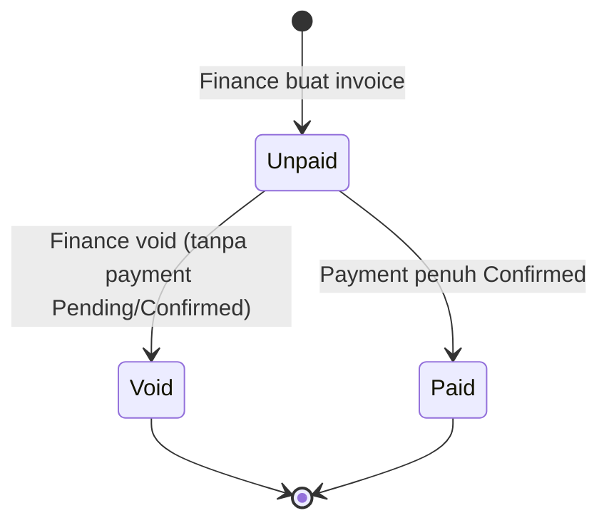

# Business Flow — Invoice

**Status:** Rancangan berdasarkan SRS v1.3 · **Acuan:** [full-flow.md](full-flow.md), [database.md](../database.md), [sales-order-term.md](sales-order-term.md), [payment.md](payment.md)

Entitas: `trans_sales_invoice_hd` + `trans_sales_invoice_dt`. Tim pelaksana: **Finance** (buat invoice dari termin Ready to Bill, void invoice bila perlu). Sistem bertanggung jawab atas kunci tahap Completed saat invoice dibuat dan kalkulasi status.

## 1. Peran & Tanggung Jawab

| Aktor | Tanggung jawab |
| --- | --- |
| Finance | Buat invoice dari termin Ready to Bill, void invoice bila perlu |
| Sistem | Kunci tahap Completed saat invoice dibuat; ubah invoice menjadi Paid setelah payment penuh Confirmed; buka kunci saat invoice Void |
| Owner | Lihat semua, override jika diperlukan |
| Marketing / Teknis | Read-only |

## 2. Konsep

Invoice adalah **tagihan** atas satu atau lebih termin Ready to Bill dalam satu Sales Order. Invoice tidak bisa gabung termin dari SO berbeda. Pembuatan invoice adalah operasi atomik: termin → Invoiced, tahap Completed → terkunci, semua dalam satu DB transaction (NFR-04).

## 3. Jenis Invoice

| Jenis | Isi | Terjadi saat |
| --- | --- | --- |
| Invoice DP | Satu termin threshold 0% | Sales Order dibuat (sebelum ada project) |
| Invoice Progress | Satu/lebih termin non-DP yang Ready to Bill | Progress project mencapai threshold |
| Invoice Pelunasan | Termin terakhir (biasanya threshold 100%) | Pekerjaan selesai |

Tiga jenis di atas adalah **cara pakai**, bukan status terpisah di `ms_status`. Semua memakai status `invoice` yang sama.

## 4. Alur Status



**Catatan:**

- `Overdue` **bukan** status tersimpan; hasil perhitungan `due_date < today() AND status = unpaid`.
- Invoice tidak dapat diedit setelah ada payment (BR-11).
- Void mengembalikan termin ke Ready to Bill (BR-09).

## 5. Daftar Status Invoice (tipe `invoice`)

| Code | Nama | Keterangan |
| --- | --- | --- |
| `unpaid` | Unpaid | Belum ada pembayaran yang dihitung |
| `paid` | Paid | Payment penuh Confirmed |
| `void` | Void | Dibatalkan; termin kembali Ready to Bill |

## 6. Field Invoice Header (`trans_sales_invoice_hd`)

| Field | Tipe | Null | Keterangan |
| --- | --- | --- | --- |
| `code` | varchar(50) | tidak | Format `INV/YY/MM/0001` |
| `transaction_date` | date | tidak | Tanggal invoice |
| `order_hd_id` | FK `trans_sales_order_hd` | tidak | SO sumber (wajib) |
| `project_hd_id` | FK `trans_project_hd` | **ya** | **Nullable** untuk invoice DP (project belum ada) |
| `quotation_hd_id` | FK `trans_sales_quotation_hd` | tidak | Untuk referensi; disalin dari SO |
| `client_id` | FK | tidak | Disalin dari SO |
| `company_id` | FK | tidak | Disalin dari SO |
| `bank_account_id` | FK `ms_bank_account` | tidak | Rekening penerima |
| `due_date` | date | tidak | Jatuh tempo |
| `subtotal` | decimal(20,6) | tidak | `none` / `include`: Σ amount termin; `exclude`: Σ amount termin dikurangi porsi PPN SO untuk termin ini |
| `vat_type` | varchar(50) | tidak | Disalin dari SO |
| `vat_amount` | decimal(20,6) | tidak | Porsi PPN SO untuk termin yang ditagih; tidak dihitung ulang sebagai pajak tambahan |
| `grand_total` | decimal(20,6) | tidak | Σ amount termin yang ditagih; `include` tidak menambah PPN, `exclude` memakai `subtotal + vat_amount` |
| `notes` | text | ya | Catatan |
| `status_id` | FK status tipe `invoice` | tidak | Default `unpaid` |

## 7. Detail Invoice (`trans_sales_invoice_dt`)

| Field | Tipe | Keterangan |
| --- | --- | --- |
| `invoice_hd_id` | FK | Header |
| `sales_term_id` | FK `trans_sales_term` | Termin yang ditagih |
| `sequence` | integer | Urutan baris |
| `description` | text | Keterangan tambahan (opsional) |
| `percentage` | integer | Snapshot `percentage` termin |
| `amount` | decimal(20,6) | Snapshot `amount` termin |

**Constraint parsial:** satu `sales_term_id` tidak boleh muncul di **invoice aktif** lain. "Aktif" = status invoice bukan `void`. Karena constraint parsial sulit di-enforce via DB di MySQL/MariaDB, validasi dilakukan di service `CreateInvoiceFromTermsService` dengan `lockForUpdate()`.

Nominal termin sudah dihitung dari `grand_total` SO (BR-02). Saat invoice dibuat, alokasikan `vat_amount` SO menurut persentase termin yang ditagih; invoice terakhir menerima selisih pembulatan agar total seluruh invoice sama dengan SO. Untuk `none`, PPN 0. Untuk `include`, PPN hanya ditampilkan sebagai bagian dari subtotal. Untuk `exclude`, `subtotal` adalah nilai termin sebelum porsi PPN. Dalam semua kasus, `grand_total` invoice tetap sama dengan jumlah `amount` termin dan tidak dikenai PPN dua kali.

## 8. Service: `CreateInvoiceFromTermsService`

**Trigger:** Finance pilih satu atau lebih termin Ready to Bill dari satu SO, klik "Buat Invoice".

**Langkah dalam satu `DB::transaction` (NFR-04):**

1. **Guard order id sama:** semua termin yang dipilih harus milik `order_hd_id` yang sama. Jika tidak, lempar `DomainException`.
2. **Guard status termin:** semua termin status `ready_to_bill`. Lock baris dengan `lockForUpdate()`.
3. **Guard termin bebas invoice aktif:** cek `trans_sales_invoice_dt` yang `sales_term_id = ?` dan join ke invoice yang status ≠ `void`. Jika ada, lempar `DomainException`.
4. **Buat invoice HD:** generate `code`, tetapkan `grand_total = Σ amount` termin, lalu alokasikan `vat_amount` dari SO dan tentukan `subtotal` sesuai `vat_type` seperti di atas. `project_hd_id` boleh null (untuk invoice DP).
5. **Buat invoice DT:** satu baris per termin, snapshot `percentage` dan `amount`.
6. **Update termin:** status → `invoiced`.
7. **Kunci tahap Completed:** jika invoice memiliki `project_hd_id`, update semua `trans_project_dt` dengan `status = completed` menjadi `editable = false` (BR-05).
8. **Catat ke project monitoring:** satu log per tahap yang terkunci (opsional, mengikuti BR-10).

**Setelah commit (di luar transaction):**

- Email ke Finance dan PIC/Teknis (opsional) tentang pembuatan invoice.

## 9. Service: `VoidInvoiceService`

**Trigger:** Action `Void` di invoice resource; visible saat `status = unpaid` dan tidak ada payment Pending/Confirmed.

**Langkah dalam satu DB transaction:**

1. **Guard:** tidak ada payment Pending/Confirmed. Jika masih ada payment Pending, Finance harus menolaknya sebelum Void.
2. **Update invoice:** `status = void`.
3. **Kembalikan termin:** semua termin di invoice ini → `status = ready_to_bill`.
4. **Unlock tahap:** untuk tiap tahap yang di-lock karena invoice ini, cek apakah masih ada invoice aktif lain yang mencakup termin yang mengunci tahap. Jika tidak ada, set `editable = true` (BR-09).
5. **Log monitoring (BR-10):** append log baru untuk tiap tahap yang berubah.

## 10. Overdue Highlight

Overdue dihitung di query, bukan status. Pattern di Filament table:

```php
TextColumn::make('due_date')
    ->label('Jatuh Tempo')
    ->date('d M Y')
    ->color(fn ($record) => $record->due_date->lt(today()) && $record->status->code === 'unpaid'
        ? 'danger'
        : null
    );
```

## 11. Business Rules yang Dijaga

| Kode | Aturan singkat |
| --- | --- |
| **BR-05** | Saat invoice dibuat, semua tahap Completed project terkunci (`editable = false`) selama project punya invoice aktif |
| **BR-06** | Sejak termin pertama ditagih, tahap tidak dapat ditambah, dihapus, atau diubah bobotnya |
| **BR-09** | Void invoice mengembalikan termin ke Ready to Bill; buka kunci tahap bila tidak ada invoice aktif lain |
| **BR-10** | Log monitoring append-only; koreksi lewat log baru |
| **BR-11** | Invoice hanya dapat diedit sebelum ada pembayaran |

Daftar BR lengkap ada di [full-flow.md §3](full-flow.md). Catatan transaksional (NFR-04 + race condition) ada di [payment.md §10](payment.md).
