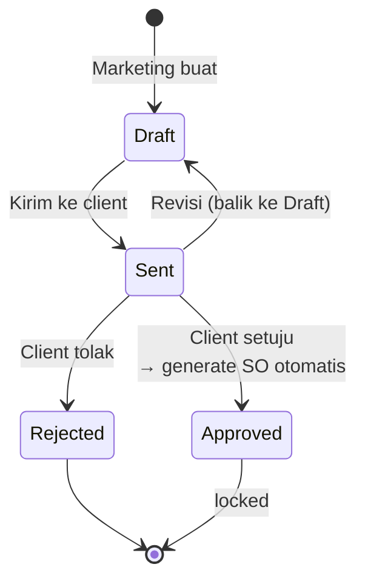
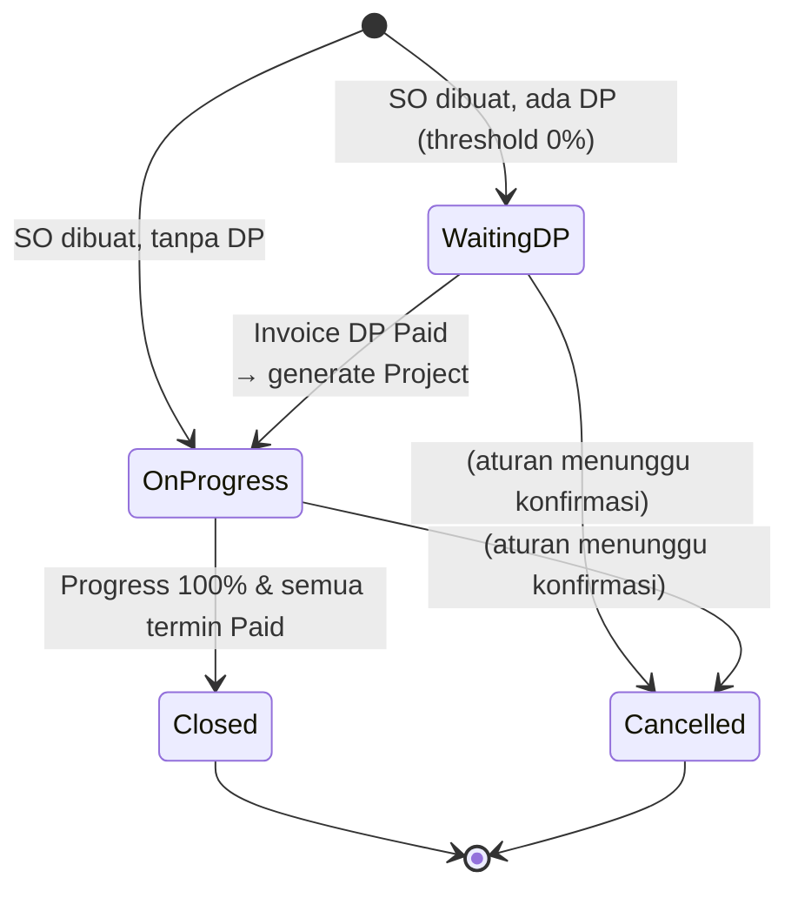
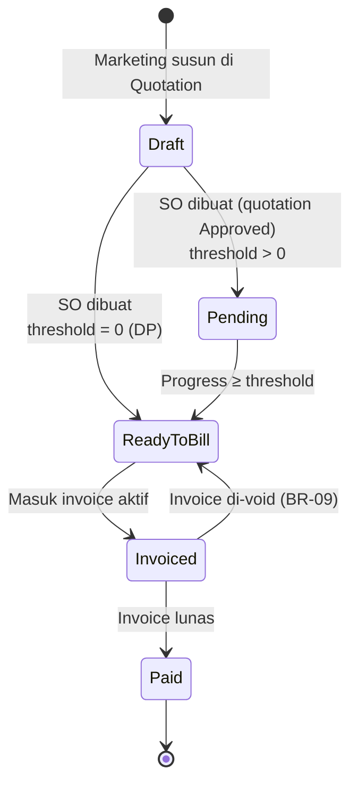

# Marketing — Quotation, Sales Order, Term

**Status:** Rancangan berdasarkan SRS v1.3 · **Acuan:** [full-flow.md](full-flow.md), [database.md](../database.md), [finance.md](finance.md)

Modul marketing mencakup tiga entitas berurutan: **Quotation → Sales Order → Term**. Tim yang menjalankan: **Marketing** (buat/kirim/revisi quotation) dan **Sistem** (generate Sales Order otomatis, kelola status termin).

## 1. Peran & Tanggung Jawab

| Aktor | Tanggung jawab |
| --- | --- |
| Marketing | Mengisi kebutuhan client, menyusun item dan skema termin, mengirim quotation, mencatat respon client, melakukan revisi |
| Sistem | Generate Sales Order otomatis saat quotation Approved, bind termin ke SO, hitung status pembayaran SO berdasarkan payment Confirmed |
| Owner | Lihat semua; override jika diperlukan |
| Finance / Teknis | Hanya melihat quotation/SO/termin (read-only) |

## 2. Quotation

### 2.1 Konsep

Quotation adalah **penawaran harga untuk negosiasi**. Isi: item (katalog jasa), jumlah, unit, harga, diskon, PPN, dan skema termin. Marketing dapat edit sampai statusnya Draft; begitu Approved, data finansial dibekukan karena akan jadi dasar Sales Order.

### 2.2 Alur Status



**Catatan transisi:**

- Dari `Draft` tidak bisa langsung ke `Approved`/`Rejected` — wajib lewat `Sent`.
- Dari `Approved`/`Rejected` tidak ada transisi balik (terkunci).
- Revisi `Sent → Draft` tidak membuat versi baru; histori perubahan status tetap tercatat (BR-12). Nomor quotation tidak berubah.

### 2.3 Field Form Quotation

| Field | Tipe | Wajib | Keterangan |
| --- | --- | --- | --- |
| `code` | varchar(50) | ya (auto) | Format `QUO/YY/MM/0001`, generate oleh `GenerateCodeService` |
| `transaction_date` | date | ya | Tanggal quotation |
| `client_id` | FK `ms_client` | ya | Client aktif |
| `project_type_id` | FK `ms_project_type` | ya | Mengikuti company (lihat FR-40) |
| `company_id` | FK `ms_company` | ya | Company penerbit |
| `payment_type` | varchar(50) | ya | Skema pembayaran bebas teks |
| `vat_type` | varchar(50) | ya | `none` / `include` / `exclude` |
| `vat_amount` | decimal(20,6) | ya (auto) | Dihitung dari detail |
| `discount_total` | decimal(20,6) | ya (auto) | Jumlah diskon detail |
| `subtotal` | decimal(20,6) | ya (auto) | Jumlah `total_price` detail |
| `grand_total` | decimal(20,6) | ya (auto) | subtotal + vat_amount − discount_total |
| `notes` | text | tidak | Catatan |
| `status_id` | FK `ms_status` tipe `quotation` | ya | Default `draft` |

### 2.4 Detail Item (`trans_sales_quotation_dt`)

| Field | Tipe | Keterangan |
| --- | --- | --- |
| `quotation_hd_id` | FK | Header |
| `item_id` | FK `ms_item` | Jasa yang ditawarkan |
| `unit_id` | FK `ms_unit` | Dibatasi oleh unit terdaftar item |
| `qty` | integer | Jumlah |
| `unit_price` | decimal(20,6) | Harga saat quotation dibuat |
| `discount` | decimal(20,6) | Diskon baris |
| `total_price` | decimal(20,6) | `qty × unit_price − discount` |
| `notes` | text (opsional) | Catatan baris |

### 2.5 Skema Termin di Quotation (`trans_sales_term`, awal)

Termin disusun di quotation. Saat dibuat, FK `order_hd_id` masih **NULL**. Status default `draft`.

| Field | Tipe | Keterangan |
| --- | --- | --- |
| `quotation_hd_id` | FK | Wajib |
| `order_hd_id` | FK, nullable | Diisi otomatis saat SO dibuat (BR-16) |
| `sequence` | integer | Urutan tampil |
| `term_name` | varchar(128) | Mis. `DP`, `Termin 1`, `Pelunasan` |
| `percentage` | integer 0–100 | Persentase (BR-01) |
| `amount` | decimal(20,6) | **0 saat Draft**; dihitung dan dikunci saat SO dibuat (BR-02) |
| `progress_threshold` | integer 0–100 | Threshold progress agar Ready to Bill |
| `notes` | text | Catatan |
| `status_id` | FK status tipe `term` | Default `draft` |

**Validasi aplikasi saat quotation disimpan:**

- Total `percentage` seluruh termin **wajib 100** (BR-01). Validasi dilakukan sebelum status pindah ke Sent.
- Minimal satu termin per quotation.
- Threshold berurutan tidak diwajibkan (urutan tampil ≠ urutan threshold).

### 2.6 Transisi oleh Service

| Service | Validasi | Side-effect |
| --- | --- | --- |
| `SendQuotationService` | Total `percentage` termin = 100; minimal 1 item dan 1 termin | `status = sent` |
| `ApproveQuotationService` | Status saat ini `sent` | `status = approved`; panggil `CreateSalesOrderFromQuotationService` dalam DB transaction yang sama (BR-17) |
| `RejectQuotationService` | Status saat ini `sent` | `status = rejected` |
| `ReviseQuotationService` | Status saat ini `sent` | `status = draft`; histori status dicatat; data finansial boleh diubah lagi |

## 3. Sales Order

### 3.1 Konsep

Sales Order adalah **kontrak penjualan** yang di-generate otomatis saat Quotation Approved. SO menjadi acuan untuk termin, project, invoice, dan payment. Dari SO, item **tidak bisa diubah** (hanya snapshot) — jika client minta ubah, Marketing revisi Quotation (balik ke Draft).

### 3.2 Alur Status



**Catatan:**

- Status `Cancelled` tersedia di `ms_status` tapi aturan pembatalan belum final (lihat SRS §6, catatan terakhir).
- Transisi SO otomatis — Marketing tidak mengubah status SO langsung.

### 3.3 Status Pembayaran SO (tipe `order_payment`)

Kolom terpisah `payment_status_id` pada `trans_sales_order_hd` — di-update otomatis dari ringkasan payment Confirmed semua invoice SO.

| Code | Nama | Pemicu |
| --- | --- | --- |
| `unpaid` | Unpaid | Belum ada termin yang Paid |
| `partial` | Partial | Sebagian termin Paid |
| `paid` | Paid | Semua termin Paid |

### 3.4 Field Sales Order Header (`trans_sales_order_hd`)

| Field | Tipe | Null | Keterangan |
| --- | --- | --- | --- |
| `code` | varchar(50) | tidak | Format `SO/YY/MM/0001` (prefix baru) |
| `transaction_date` | date | tidak | Tanggal SO dibuat (= tanggal quotation Approved) |
| `quotation_hd_id` | FK `trans_sales_quotation_hd` | tidak | **Unique** — satu quotation hanya satu SO (BR-17) |
| `client_id` | FK | tidak | Disalin dari quotation |
| `project_type_id` | FK | tidak | Disalin dari quotation |
| `company_id` | FK | tidak | Disalin dari quotation |
| `payment_type` | varchar(50) | tidak | Disalin dari quotation |
| `vat_type` | varchar(50) | tidak | Disalin dari quotation |
| `vat_amount` | decimal(20,6) | tidak | Disalin dari quotation |
| `discount_total` | decimal(20,6) | tidak | Disalin dari quotation |
| `subtotal` | decimal(20,6) | tidak | Disalin dari quotation |
| `grand_total` | decimal(20,6) | tidak | Disalin dari quotation |
| `notes` | text | ya | Catatan tambahan |
| `status_id` | FK status tipe `order` | tidak | `waiting_dp` atau `on_progress` |
| `payment_status_id` | FK status tipe `order_payment` | tidak | Default `unpaid` |

### 3.5 Detail Item (`trans_sales_order_dt`)

Snapshot dari `trans_sales_quotation_dt` saat SO dibuat.

| Field | Tipe | Keterangan |
| --- | --- | --- |
| `order_hd_id` | FK | Header SO |
| `quotation_dt_id` | FK `trans_sales_quotation_dt` | Pointer ke baris sumber (opsional, untuk audit) |
| `item_id` | FK `ms_item` | — |
| `unit_id` | FK `ms_unit` | — |
| `qty` | integer | Disalin |
| `unit_price` | decimal(20,6) | Disalin |
| `discount` | decimal(20,6) | Disalin |
| `total_price` | decimal(20,6) | Disalin |
| `notes` | text | Disalin |

### 3.6 Service: `CreateSalesOrderFromQuotationService`

**Dipanggil dari:** `ApproveQuotationService::execute()` dalam satu `DB::transaction` (BR-17).

**Langkah:**

1. **Guard:** quotation status = `sent`. Jika sudah pernah punya SO (unique FK), lempar `DomainException`.
2. **Buat HD:** copy semua field finansial dari `trans_sales_quotation_hd` ke `trans_sales_order_hd`. Generate `code` via `GenerateCodeService(AutoCodePrefix::TransSalesOrderHd)`.
3. **Copy item:** salin seluruh `trans_sales_quotation_dt` ke `trans_sales_order_dt`.
4. **Bind termin:** update `trans_sales_term` yang terkait quotation — set `order_hd_id`, hitung `amount = percentage × grand_total / 100`, dan transisi status:
   - Termin dengan `progress_threshold = 0` → status `ready_to_bill` (DP).
   - Termin lainnya → status `pending`.
5. **Set status SO:** jika ada termin DP → `waiting_dp`, kalau tidak → `on_progress` + panggil `CreateProjectFromSalesOrderService` (BR-15 case tanpa DP).
6. **Set payment status SO:** `unpaid`.
7. **Notifikasi (di luar transaction):**
   - Jika ada DP → email ke Finance "Termin DP siap ditagih".
   - Jika tidak ada DP → email ke Teknis + PIC "Project siap dikerjakan" (dari service pembuatan project).

### 3.7 Pembuatan Project

- **Ada DP:** project dibuat setelah invoice DP berstatus Paid (lihat `ConfirmPaymentService` di [finance.md](finance.md)).
- **Tidak ada DP:** project dibuat bersamaan dengan SO.

Service `CreateProjectFromSalesOrderService` (detail di dokumen project — belum ditulis) menyalin `client_id`, `company_id`, `project_type_id` dari SO, generate `code` project, lalu panggil `CreateProjectStagesService` untuk copy workflow jadi tahap.

## 4. Term

### 4.1 Konsep

Term (termin) menyatakan **cicilan pembayaran** atas Sales Order. Disusun di Quotation, dikelola di SO. Satu termin punya `percentage` dan `progress_threshold`. Nilai (`amount`) dibekukan saat SO dibuat.

### 4.2 Alur Status



### 4.3 Daftar Status Termin (tipe `term`)

| Code | Nama | Keterangan |
| --- | --- | --- |
| `draft` | Draft | Termin masih di quotation, belum disetujui |
| `pending` | Pending | Threshold belum tercapai |
| `ready_to_bill` | Ready to Bill | Threshold tercapai, siap invoice |
| `invoiced` | Invoiced | Sudah masuk invoice aktif |
| `paid` | Paid | Invoice lunas dari payment Confirmed |

### 4.4 Logika Transisi Otomatis

Transisi `pending → ready_to_bill` dicek pada tiga titik (BR-04):

1. Saat SO dibuat (service `CreateSalesOrderFromQuotationService`).
2. Saat Project dibuat (ambil kondisi awal progress).
3. Setiap kali progress project berubah (service `UpdateProjectStageService`).

Pseudocode cek threshold:

```php
foreach ($order->terms()->where('status', 'pending')->get() as $term) {
    if ($project->progress_percentage >= $term->progress_threshold) {
        $term->update(['status_id' => $this->getStatusId('term', 'ready_to_bill')]);
        // email ke Finance
    }
}
```

**Catatan:** termin tidak jadi Ready to Bill jika sudah masuk invoice aktif (dicek via `trans_sales_invoice_dt`).

### 4.5 DP: termin khusus threshold 0%

- DP didefinisikan sebagai termin dengan `progress_threshold = 0` (BR-04). Tidak bergantung pada urutan atau besar persentase.
- DP langsung `ready_to_bill` saat SO dibuat.
- Satu quotation **boleh punya 0 atau 1 termin DP** (praktik umum). Multiple DP tidak dilarang schema, tapi semua akan Ready to Bill bersama saat SO dibuat.
- Full Payment direpresentasikan sebagai satu termin 100% dengan threshold 0 (bayar di depan) atau threshold 100 (bayar setelah selesai).

## 5. Resource Filament yang Dibutuhkan

| Resource | Group | Keterangan |
| --- | --- | --- |
| `TransSalesQuotationHdResource` | Penjualan | List + Create + View + Edit. Relation manager untuk item dan termin. Custom action: Send, Approve, Reject, Revisi. |
| `TransSalesOrderHdResource` | Penjualan | List + View (read-mostly). Tidak ada Create — SO di-generate dari quotation. Relation manager untuk item (read-only), termin (read + edit terbatas), invoice (read). |

### 5.1 Relation Manager

Pada `TransSalesQuotationHdResource`:

- **ItemsRelationManager** → `trans_sales_quotation_dt`. Edit hanya saat quotation Draft.
- **TermsRelationManager** → `trans_sales_term` yang `quotation_hd_id = this`. Edit hanya saat quotation Draft; validasi total 100% di submit.

Pada `TransSalesOrderHdResource`:

- **ItemsRelationManager** → `trans_sales_order_dt`, read-only.
- **TermsRelationManager** → `trans_sales_term` yang `order_hd_id = this`. Tampilkan status; edit terbatas (misal catatan).
- **InvoicesRelationManager** → `trans_sales_invoice_hd`, read-only; link ke resource invoice.

### 5.2 Custom Action di Quotation

- `SendAction` — visible saat status `draft`.
- `ApproveAction` — visible saat status `sent`; `requiresConfirmation` dengan modal yang menjelaskan konsekuensi (SO akan dibuat, data terkunci).
- `RejectAction` — visible saat status `sent`.
- `ReviseAction` — visible saat status `sent`.
- `PrintPdfAction` — visible saat status `approved` (dan opsional `sent`).

## 6. Checklist Implementasi (Marketing)

- [ ] Migration `trans_sales_quotation_hd` + `trans_sales_quotation_dt` (gunakan `TransactionTableColumns`).
- [ ] Migration `trans_sales_order_hd` + `trans_sales_order_dt`.
- [ ] Migration `trans_sales_term` dengan FK `quotation_hd_id` wajib dan `order_hd_id` nullable.
- [ ] Model Eloquent: `TransSalesQuotationHd/Dt`, `TransSalesOrderHd/Dt`, `TransSalesTerm`.
- [ ] Update seeder `MsStatus`: 31 status total; tambah `order`, `order_payment`, update `project`, `project_dt`, `term`, `invoice`.
- [ ] Enum PHP di `app/Enums/Status/`: `OrderStatus`, `OrderPaymentStatus`; update `ProjectStatus`, `ProjectDtStatus`, `TermStatus`, `InvoiceStatus`.
- [ ] Tambah case di `AutoCodePrefix`: `TransSalesOrderHd = 'SO'` (atau `ORD`).
- [ ] Service: `SendQuotationService`, `ApproveQuotationService`, `RejectQuotationService`, `ReviseQuotationService`, `CreateSalesOrderFromQuotationService`.
- [ ] Resource Filament + relation manager + custom action.
- [ ] Notification: `TermReadyToBillNotification`, `OrderCreatedNotification` (opsional).
- [ ] Test unit untuk service dan test feature untuk flow Approve → SO terbentuk.
