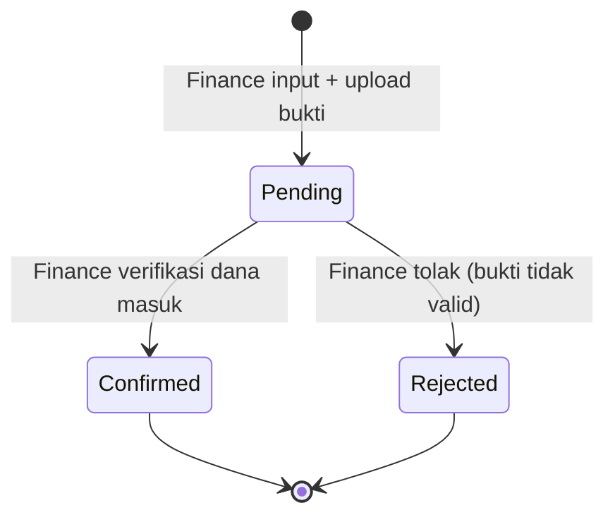

# Business Flow — Payment

**Status:** Rancangan berdasarkan SRS v1.3 · **Acuan:** [full-flow.md](full-flow.md), [database.md](../database.md), [invoice.md](invoice.md), [sales-order-term.md](sales-order-term.md)

Entitas: `trans_sales_payment`. Tim pelaksana: **Finance** (catat payment, konfirmasi/tolak). Sistem bertanggung jawab atas kalkulasi status invoice/SO dan membuka akses pembuatan Project manual setelah DP Paid; Project tidak dibuat oleh service Payment.

## 1. Peran & Tanggung Jawab

| Aktor | Tanggung jawab |
| --- | --- |
| Finance | Catat payment, konfirmasi/tolak payment |
| Sistem | Ubah invoice menjadi Paid setelah pembayaran penuh dikonfirmasi; hitung `payment_status` SO; izinkan pembuatan Project manual saat DP Paid; tutup SO saat progress 100% & semua termin Paid |
| Owner | Lihat semua, override jika diperlukan |
| Marketing / Teknis | Read-only |

## 2. Konsep

Payment adalah **catatan pembayaran penuh** atas satu invoice. Alur saat ini tidak menerima cicilan: nominal payment harus sama dengan `grand_total` invoice, dan hanya satu payment berstatus Pending atau Confirmed yang boleh ada untuk invoice yang sama. Payment Rejected tidak mengurangi tagihan dan boleh diganti dengan payment baru.

## 3. Alur Status



**Catatan:** Payment Confirmed/Rejected tidak dapat diubah lagi — jika salah, buat payment baru atau koreksi lewat `ReversePaymentService` (belum ada, perlu CR).

## 4. Daftar Status Payment (tipe `payment`)

| Code | Nama | Keterangan |
| --- | --- | --- |
| `pending` | Pending | Bukti transfer diunggah, belum diverifikasi |
| `confirmed` | Confirmed | Finance pastikan dana masuk; dihitung ke invoice |
| `rejected` | Rejected | Ditolak; tidak dihitung |

## 5. Field Payment (`trans_sales_payment`)

| Field | Tipe | Null | Keterangan |
| --- | --- | --- | --- |
| `code` | varchar(50) | tidak | Format `PAY/YY/MM/0001` |
| `transaction_date` | date | tidak | Tanggal transfer / cash |
| `invoice_hd_id` | FK `trans_sales_invoice_hd` | tidak | Invoice yang dibayar |
| `amount` | decimal(20,6) | tidak | Nominal pembayaran |
| `payment_method` | varchar(128) | tidak | Enum: `cash`, `transfer`, `giro`, dll. (enum PHP `PaymentMethod`) |
| `reference_no` | varchar(50) | ya | Nomor referensi/transaksi bank; null untuk cash |
| `payment_proof` | varchar(255) | ya | Path file bukti transfer (disk `public`) |
| `notes` | text | ya | Catatan |
| `status_id` | FK status tipe `payment` | tidak | Default `pending` |

## 6. Service: `RecordPaymentService`

**Trigger:** Finance input payment dari relation manager invoice.

**Langkah:**

1. **Guard invoice:** status invoice harus `unpaid`. Invoice `void` atau `paid` tidak dapat menerima payment baru.
2. **Guard amount dan duplikat:** `amount = grand_total` invoice, dan tidak ada payment Pending atau Confirmed lain untuk invoice tersebut.
3. **Buat payment:** generate `code`, status default `pending`.
4. **Simpan file bukti:** upload ke `payments/proof` di disk public.

## 7. Service: `ConfirmPaymentService`

**Trigger:** Action `Confirm` di payment resource; visible saat `status = pending`.

**Langkah dalam DB transaction:**

1. **Guard:** payment status = `pending`, invoice masih `unpaid`, dan tidak ada payment Confirmed lain untuk invoice tersebut.
2. **Update payment:** `status = confirmed`.
3. **Lunasi invoice:** pastikan `amount = grand_total`; invoice status → `paid`, semua termin invoice ini → `paid`.
4. **Hitung ulang payment status SO** via `RecalculateOrderPaymentStatusService` (lihat [sales-order-term.md §4](sales-order-term.md)).
5. **Buka akses pembuatan Project (BR-15):**
   - Jika invoice DP (threshold 0%) sekarang Paid, SO dapat dipilih di form Create Project. Konfirmasi payment tidak membuat Project dan belum mengubah status SO menjadi `on_progress`.
6. **Trigger penutupan SO (BR-13):**
   - Jika SO sudah punya Project, cek `progress_percentage = 100` dan `payment_status = paid` → SO status = `closed`. Project status = `completed` jika belum.

**Setelah commit:** SO dengan DP Paid muncul sebagai pilihan pembuatan Project bagi user berwenang. Email ke Teknis + PIC dikirim satu kali setelah Project benar-benar dibuat dan PIC sudah diisi, bukan saat payment dikonfirmasi.

## 8. Service: `RejectPaymentService`

**Trigger:** Action `Reject` di payment resource; visible saat `status = pending`.

**Langkah:**

1. **Update payment:** `status = rejected`.
2. **Tidak ada perubahan invoice/SO** karena payment Rejected tidak dihitung.

## 9. Dashboard Finance (FR-41 — fase berikutnya)

Widget khusus Finance ditunda ke fase berikutnya. Saat diimplementasikan, query harus memakai relasi `status` atau FK `status_id` karena tabel transaksi tidak memiliki kolom `status` berupa kode:

| Widget | Query |
| --- | --- |
| Termin Ready to Bill | `TransSalesTerm::whereRelation('status', 'code', 'ready_to_bill')->count()` |
| Invoice Outstanding | `TransSalesInvoiceHd::whereRelation('status', 'code', 'unpaid')->count()` |
| Total Outstanding | `Σ grand_total` dari invoice Unpaid |
| Overdue | Invoice Unpaid dengan `due_date < today()` |
| Revenue Bulan Ini | `Σ amount payment confirmed di bulan ini` |

Chart tambahan:

- Payment Confirmed per Bulan (bar chart) — 12 bulan terakhir.
- Invoice per Status (doughnut) — distribusi status.

## 10. Catatan Transaksional

### 10.1 NFR-04 — Konsistensi

Operasi berikut **wajib** dalam satu `DB::transaction`:

1. Pembuatan invoice: insert HD + insert DT + update termin + lock tahap (lihat [invoice.md §8](invoice.md)).
2. Confirm payment: update payment + hitung invoice + hitung SO payment_status; DP Paid membuat SO layak dipilih untuk pembuatan Project manual.
3. Void invoice: update invoice + kembalikan termin + unlock tahap (sesuai kondisi).

### 10.2 Race condition pada pembuatan invoice bersamaan

Dua user Finance klik "Buat Invoice" dari termin yang sama di waktu bersamaan. Pencegahan:

```php
$terms = TransSalesTerm::whereIn('id', $termIds)
    ->where('status_id', $readyToBillStatusId)
    ->lockForUpdate()  // SELECT ... FOR UPDATE
    ->get();
```

Jika row sudah dikunci user lain, request kedua antre; saat dapat giliran, status termin sudah `invoiced` → service lempar `DomainException`.

### 10.3 Payment status SO perlu di-recompute, bukan increment

Saat payment confirmed/rejected/voided, jangan simpan counter manual di SO. Hitung ulang dari sumber:

```php
$totalTerms = $order->terms()->count();
$paidTerms = $order->terms()->whereRelation('status', 'code', 'paid')->count();

$paymentStatus = match (true) {
    $paidTerms === 0 => 'unpaid',
    $paidTerms < $totalTerms => 'partial',
    default => 'paid',
};
```

## 11. Business Rules yang Dijaga

| Kode | Aturan singkat |
| --- | --- |
| **BR-13** | Sales Order Closed hanya jika progress project 100% dan semua termin Paid |
| **BR-15** | Project dibuat manual setelah invoice DP Paid; email ke Teknis + PIC setelah Project tersimpan |

Daftar BR lengkap ada di [full-flow.md §3](full-flow.md).
