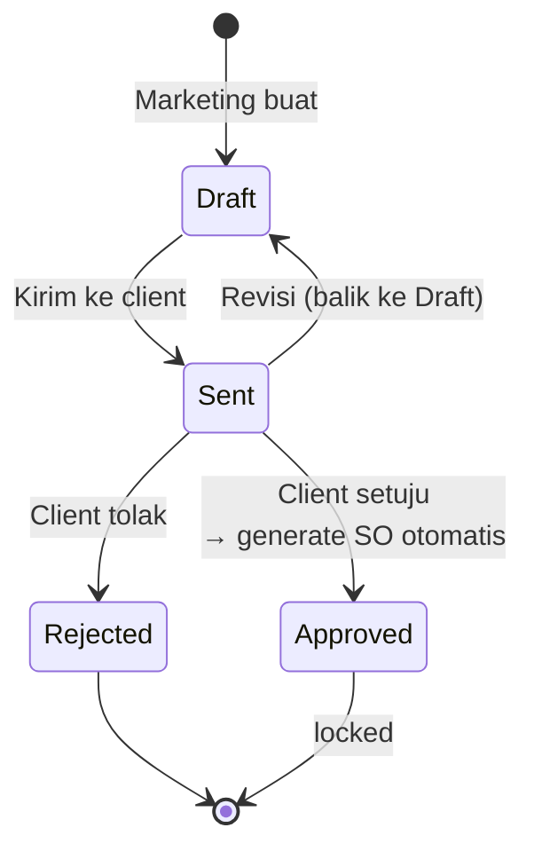

# Business Flow — Quotation

**Status:** Rancangan berdasarkan SRS v1.3 · **Acuan:** [full-flow.md](full-flow.md), [database.md](../database.md), [sales-order-term.md](sales-order-term.md)

Entitas: `trans_sales_quotation_hd` + `trans_sales_quotation_dt`. Tim pelaksana: **Marketing** (buat, kirim, revisi, catat respon client).

## 1. Peran & Tanggung Jawab

| Aktor | Tanggung jawab |
| --- | --- |
| Marketing | Mengisi kebutuhan client, menyusun item dan skema termin, mengirim quotation, mencatat respon client, melakukan revisi |
| Sistem | Validasi total termin, lock data finansial sesaat setelah Approved |
| Owner | Lihat semua, override jika diperlukan |
| Finance / Teknis | Read-only |

## 2. Konsep

Quotation adalah **penawaran harga untuk negosiasi**. Isi: item (katalog jasa), jumlah, unit, harga, diskon, PPN, dan skema termin. Marketing dapat edit sampai statusnya Draft; begitu Approved, data finansial dibekukan karena akan jadi dasar Sales Order (lihat [sales-order-term.md](sales-order-term.md)).

## 3. Alur Status

**Catatan transisi:**

- Dari `Draft` tidak bisa langsung ke `Approved` / `Rejected` — wajib lewat `Sent`.
- Dari `Approved` / `Rejected` tidak ada transisi balik (terkunci).
- Revisi `Sent → Draft` tidak membuat versi baru; histori perubahan status tetap tercatat (BR-12). Nomor quotation tidak berubah.

## 4. Field Form Quotation Header

| Field | Tipe | Wajib | Keterangan |
| --- | --- | --- | --- |
| `code` | varchar(50) | ya (auto) | Format `QUO/YY/MM/0001`, generate oleh `GenerateCodeService` |
| `transaction_date` | date | ya | Tanggal quotation |
| `client_id` | FK `ms_client` | ya | Client aktif |
| `project_type_id` | FK `ms_project_type` | ya | Mengikuti company (FR-40) |
| `company_id` | FK `ms_company` | ya | Company penerbit |
| `payment_type` | varchar(50) | ya | Skema pembayaran bebas teks |
| `vat_type` | varchar(50) | ya | `none` / `include` / `exclude` |
| `vat_amount` | decimal(20,6) | ya (auto) | `none`: 0; `include`: porsi PPN di dalam subtotal; `exclude`: PPN di atas subtotal |
| `discount_total` | decimal(20,6) | ya (auto) | Jumlah `discount` detail; informasi, tidak dikurangkan lagi dari subtotal |
| `subtotal` | decimal(20,6) | ya (auto) | Jumlah `total_price` detail yang sudah dikurangi diskon baris |
| `grand_total` | decimal(20,6) | ya (auto) | `none` / `include`: subtotal; `exclude`: subtotal + vat_amount; diskon tidak dikurangkan ulang |
| `notes` | text | tidak | Catatan |
| `status_id` | FK `ms_status` tipe `quotation` | ya | Default `draft` |

## 5. Detail Item (`trans_sales_quotation_dt`)

| Field | Tipe | Keterangan |
| --- | --- | --- |
| `quotation_hd_id` | FK | Header |
| `item_id` | FK `ms_item` | Jasa yang ditawarkan |
| `unit_id` | FK `ms_unit` | Dibatasi oleh unit terdaftar item |
| `qty` | integer | Jumlah |
| `unit_price` | decimal(20,6) | Harga saat quotation dibuat |
| `discount` | decimal(20,6) | Diskon baris |
| `total_price` | decimal(20,6) | `qty × unit_price − discount`; sudah setelah diskon baris |
| `notes` | text (opsional) | Catatan baris |

Tarif PPN mengikuti contoh Sanitra (BR-14). Jika tarifnya `r`, `vat_amount` untuk `include` adalah `subtotal × r / (1 + r)`, sedangkan untuk `exclude` adalah `subtotal × r`. Perhitungan dan pembulatan nominal harus konsisten sampai invoice.

## 6. Skema Termin di Quotation

Termin disusun di quotation sebagai bagian dari penawaran. Setelah quotation Approved, pengelolaan termin pindah ke Sales Order (BR-16). Detail field termin, status, dan logika transisi otomatis ada di [sales-order-term.md §3](sales-order-term.md).

**Validasi aplikasi saat quotation disimpan:**

- Total `percentage` seluruh termin **wajib 100** (BR-01). Validasi dilakukan sebelum status pindah ke Sent.
- Tepat satu termin DP dengan `progress_threshold = 0` wajib didefinisikan sebelum Quotation dikirim; termin lain boleh memakai threshold progress di atas 0. Ini validasi skema termin, bukan kewajiban membayar DP sebelum SO dibuat.
- Threshold berurutan tidak diwajibkan (urutan tampil ≠ urutan threshold).

## 7. Service Transisi

| Service | Validasi | Side-effect |
| --- | --- | --- |
| `SendQuotationService` | Total `percentage` termin = 100; minimal 1 item; tepat satu termin DP threshold 0% | `status = sent` |
| `ApproveQuotationService` | Status saat ini `sent` | `status = approved`; panggil `CreateSalesOrderFromQuotationService` dalam DB transaction yang sama (BR-17) |
| `RejectQuotationService` | Status saat ini `sent` | `status = rejected` |
| `ReviseQuotationService` | Status saat ini `sent` | `status = draft`; histori status dicatat; data finansial boleh diubah lagi |

Semua service memakai pola `DB::transaction` dengan notifikasi di luar transaction (lihat [architecture.md](../architecture.md) §2.1 dan [filament-lifecycle-hook.md](../filament-lifecycle-hook.md)).

## 8. Business Rules yang Dijaga

| Kode | Aturan singkat |
| --- | --- |
| **BR-01** | Total persentase termin satu quotation = 100%; bilangan bulat |
| **BR-11** | Quotation hanya dapat diedit saat Draft |
| **BR-12** | Revisi quotation = kembalikan status Sent → Draft; tidak ada nomor revisi atau versi terpisah |
| **BR-17** | Pembuatan Sales Order dari Quotation Approved dalam satu DB transaction (satu Quotation → satu Sales Order) |

Daftar BR lengkap ada di [full-flow.md §3](full-flow.md).
