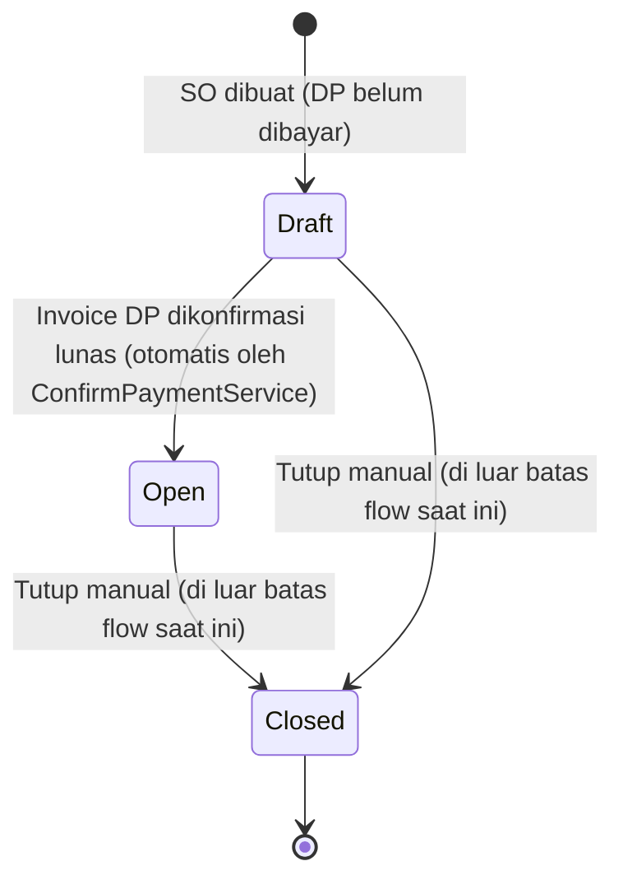
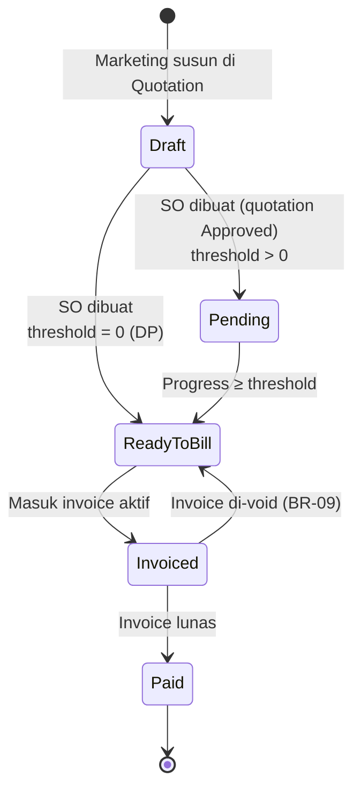

# Business Flow — Sales Order & Term

**Status:** Rancangan berdasarkan SRS v1.3 · **Acuan:** [full-flow.md](full-flow.md), [database.md](../database.md), [quotation.md](quotation.md), [invoice.md](invoice.md)

Entitas: `trans_sales_order_hd` + `trans_sales_order_dt` + `trans_sales_term`. Tim pelaksana: **Sistem** (generate SO otomatis, bind termin, transisi status SO otomatis) dengan konfirmasi dari **Marketing**.

## 1. Peran & Tanggung Jawab

| Aktor | Tanggung jawab |
| --- | --- |
| Sistem | Generate Sales Order otomatis saat quotation Approved, bind termin ke SO, transisi SO ke `open` otomatis setelah DP Paid |
| Marketing | Memastikan konten quotation yang jadi dasar SO sudah benar; tidak boleh mengubah SO (hanya revisi di Quotation yang dikembalikan ke Draft) |
| Owner | Lihat semua; override jika diperlukan |
| Finance / Teknis | Read-only |

## 2. Sales Order

### 2.1 Konsep

Sales Order adalah **kontrak penjualan** yang di-generate otomatis saat Quotation Approved. SO menjadi acuan untuk termin, project, invoice, dan payment. Item di SO **tidak bisa diubah** (hanya snapshot). Quotation yang sudah Approved juga tidak dapat direvisi; perubahan item setelah SO terbentuk belum menjadi bagian alur ini.

### 2.2 Alur Status



**Badge status saat `closed`** bergantung pada `close_reason`:
- `completed` → label "Selesai" (hijau)
- `manual` → label "Ditutup" (abu-abu)

**Catatan:** Transisi SO ke `open` terjadi otomatis di `ConfirmPaymentService` saat termin DP (threshold 0%) dikonfirmasi lunas — Marketing tidak mengubah status SO secara langsung.

### 2.3 Ringkasan Status Pembayaran (Computed)

Tidak ada kolom tersendiri untuk status pembayaran SO. Ringkasan dihitung secara komputasi dari metode `paymentSummary()` pada model (bukan kolom database) — dibaca dari status termin SO.

| Hasil | Kondisi |
| --- | --- |
| Lunas | Semua termin berstatus `paid` |
| Dibayar Sebagian | Sebagian termin berstatus `paid` |
| Belum Dibayar | Tidak ada termin yang `paid` |

### 2.4 Field Sales Order Header (`trans_sales_order_hd`)

| Field | Tipe | Null | Keterangan |
| --- | --- | --- | --- |
| `code` | varchar(50) | tidak | Format `SO/YY/MM/0001` (prefix baru) |
| `transaction_date` | date | tidak | Tanggal saat SO dibuat ketika quotation disetujui |
| `quotation_hd_id` | FK `trans_sales_quotation_hd` | tidak | **Unique** — satu quotation hanya satu SO (BR-17) |
| `client_id` | FK | tidak | Disalin dari quotation |
| `project_type_id` | FK | tidak | Disalin dari quotation |
| `company_id` | FK | tidak | Disalin dari quotation |
| `payment_type` | varchar(50) | tidak | Disalin dari quotation |
| `vat_type` | varchar(50) | tidak | Disalin dari quotation |
| `vat_amount` | decimal(20,6) | tidak | Disalin dari quotation |
| `discount_total` | decimal(20,6) | tidak | Disalin dari quotation |
| `subtotal` | decimal(20,6) | tidak | Disalin dari quotation |
| `grand_total` | decimal(20,6) | tidak | Disalin dari quotation |
| `notes` | text | ya | Catatan tambahan |
| `close_reason` | varchar(32) | ya | Alasan yang dicatat saat SO ditutup; null saat belum closed |
| `close_notes` | text | ya | Catatan tambahan saat SO ditutup manual; null bila tidak ada |
| `status_id` | FK status tipe `order` | tidak | Awalnya `draft`; transisi otomatis ke `open` setelah DP Paid. Penutupan SO adalah flow terpisah setelah batas SO siap dibuatkan Project. |

### 2.5 Detail Item (`trans_sales_order_dt`)

Snapshot dari `trans_sales_quotation_dt` saat SO dibuat.

| Field | Tipe | Keterangan |
| --- | --- | --- |
| `order_hd_id` | FK | Header SO |
| `quotation_dt_id` | FK `trans_sales_quotation_dt` | Pointer ke baris sumber (audit) |
| `item_id` | FK `ms_item` | — |
| `unit_id` | FK `ms_unit` | — |
| `qty` | integer | Disalin |
| `unit_price` | decimal(20,6) | Disalin |
| `discount` | decimal(20,6) | Disalin |
| `total_price` | decimal(20,6) | Disalin |
| `notes` | text | Disalin |

### 2.6 Service: `CreateSalesOrderFromQuotationService`

**Dipanggil dari:** `ApproveQuotationService::execute()` dalam satu `DB::transaction` (BR-17).

**Langkah:**

1. **Guard:** quotation status = `sent`. Jika sudah pernah punya SO (unique FK), lempar `DomainException`.
2. **Buat HD:** copy semua field finansial dari `trans_sales_quotation_hd` ke `trans_sales_order_hd`. Generate `code` via `GenerateCodeService(AutoCodePrefix::TransSalesOrderHd)`.
3. **Copy item:** salin seluruh `trans_sales_quotation_dt` ke `trans_sales_order_dt`.
4. **Bind termin:** update `trans_sales_term` yang terkait quotation — set `order_hd_id`, hitung `amount = percentage × grand_total / 100`, dan transisi status:
   - Termin dengan `progress_threshold = 0` → status `ready_to_bill` (DP).
   - Termin lainnya → status `pending`.
5. **Set status SO:** `draft`. Tepat satu termin DP sudah divalidasi sebelum Quotation dikirim.
6. **Notifikasi (di luar transaction):** email ke Finance "Termin DP siap ditagih".

### 2.7 Pembuatan Project

- Setelah invoice DP berstatus Paid, `ConfirmPaymentService` secara otomatis mengubah SO dari `draft` → `open`. SO `open` menjadi penanda bahwa DP sudah lunas dan Project dapat dibuat.
- User berwenang dapat membuat Project dari SO `open` yang belum memiliki Project, lewat form di halaman View SO.

Form Project meminta `pic_employee_id`, `project_name`, `start_date`, dan `end_date`. Service `CreateProjectFromSalesOrderService` memeriksa status SO = `open` dan belum ada Project, menyalin `client_id`, `company_id`, `project_type_id` dari SO, membuat kode Project dengan status awal **`on_progress`** (bukan `open`), lalu memanggil `CreateProjectStagesService` untuk menyalin workflow menjadi tahap dalam satu transaksi database. Status SO **tidak berubah** saat Project dibuat — SO tetap `open` sampai ditutup oleh `CloseOrderService`.

### 2.8 Penutupan SO (`CloseOrderService`) — flow lanjutan

Bagian ini berada di luar batas flow saat ini, yang berakhir saat SO `open` dan siap dibuatkan Project. Action penutupan manual tersedia di halaman SO untuk pengguna dengan izin update. Penutupan otomatis setelah Project selesai/semua termin lunas belum diimplementasikan.

Guard `CloseOrderService`:
1. Status SO harus `draft` atau `open`.
2. Tidak ada invoice dengan status `unpaid`.
3. Jika SO punya project berstatus `on_progress` → project diubah ke `cancelled` sebelum SO ditutup.

## 3. Term

### 3.1 Konsep

Term (termin) menyatakan **tahapan penagihan** atas Sales Order. Disusun di Quotation, dikelola di SO. Satu termin punya `percentage` dan `progress_threshold`. Nilai (`amount`) dibekukan saat SO dibuat. Setiap invoice termin dibayar penuh; tidak ada cicilan atas satu invoice pada alur saat ini.

### 3.2 Alur Status



### 3.3 Daftar Status Termin (tipe `term`)

| Code | Nama | Keterangan |
| --- | --- | --- |
| `draft` | Draft | Termin masih di quotation, belum disetujui |
| `pending` | Pending | Threshold belum tercapai |
| `ready_to_bill` | Ready to Bill | Threshold tercapai, siap invoice |
| `invoiced` | Invoiced | Sudah masuk invoice aktif |
| `paid` | Paid | Invoice lunas dari payment Confirmed |

### 3.4 Field Termin (`trans_sales_term`)

Termin disusun di quotation. Saat dibuat, FK `order_hd_id` masih **NULL**; diisi otomatis saat SO dibuat (BR-16).

| Field | Tipe | Keterangan |
| --- | --- | --- |
| `quotation_hd_id` | FK | Wajib |
| `order_hd_id` | FK, nullable | Diisi otomatis saat SO dibuat (BR-16) |
| `sequence` | integer | Urutan tampil |
| `term_name` | varchar(128) | Mis. `DP`, `Termin 1`, `Pelunasan` |
| `percentage` | integer 0–100 | Persentase (BR-01) |
| `amount` | decimal(20,6) | **0 saat Draft**; dihitung dan dikunci saat SO dibuat (BR-02) |
| `progress_threshold` | integer 0–100 | Threshold progress agar Ready to Bill |
| `notes` | text | Catatan |
| `status_id` | FK status tipe `term` | Default `draft` |

### 3.5 Logika Transisi Otomatis `pending → ready_to_bill`

Transisi dicek pada tiga titik (BR-04):

1. Saat SO dibuat (service `CreateSalesOrderFromQuotationService`).
2. Saat Project dibuat (ambil kondisi awal progress).
3. Setiap kali progress project berubah (service `UpdateProjectStageService`).

Pseudocode cek threshold:

```php
foreach ($order->terms()->whereRelation('status', 'code', 'pending')->get() as $term) {
    if ($project->progress_percentage >= $term->progress_threshold) {
        $term->update(['status_id' => $this->getStatusId('term', 'ready_to_bill')]);
        // email ke Finance via TermReadyToBillNotification
    }
}
```

**Catatan:** termin tidak jadi Ready to Bill jika sudah masuk invoice aktif (dicek via `trans_sales_invoice_dt`).

### 3.6 DP: termin khusus threshold 0%

- DP didefinisikan sebagai termin dengan `progress_threshold = 0` (BR-04). Tidak bergantung pada urutan atau besar persentase.
- DP langsung `ready_to_bill` saat SO dibuat.
- Satu quotation **wajib punya tepat satu termin DP** pada alur saat ini. Schema tidak membatasi jumlah DP; validasi dilakukan sebelum Quotation menjadi Sent.
- Full Payment dalam alur saat ini direpresentasikan sebagai satu termin DP 100% dengan threshold 0 (bayar di depan). Opsi pembayaran seluruhnya setelah progress 100% memerlukan alur Project tanpa DP yang ditunda.

## 4. Service Pendamping

| Service | Lokasi | Fungsi |
| --- | --- | --- |
| `CreateSalesOrderFromQuotationService` | `Services/SalesOrder/` | Copy HD/DT, bind termin, set status SO `draft` — satu DB transaction (BR-17) |
| `CheckTermReadyToBillService` | `Services/SalesOrder/` | Cek termin pending yang melewati threshold progress; dipicu saat SO dibuat, Project dibuat, progress tahap berubah |
| `CloseOrderService` | `Services/SalesOrder/` | Tutup SO (`closed`) dengan `close_reason` + `close_notes`; guard tidak ada invoice unpaid; cancel project on_progress |

## 5. Business Rules yang Dijaga

| Kode | Aturan singkat |
| --- | --- |
| **BR-02** | `amount` termin = persentase × grand total quotation; dihitung dan dikunci saat Sales Order dibuat |
| **BR-04** | Termin Ready to Bill saat `progress ≥ threshold` dan belum di invoice aktif |
| **BR-13** | Penutupan otomatis setelah Project selesai/semua termin `paid` belum diimplementasikan; flow ini berakhir di SO `open`. |
| **BR-15** | Tepat satu DP threshold 0% wajib ada; setelah DP Paid SO otomatis `open` dan siap dibuatkan Project. Proses setelah Project dibuat adalah tahap berikutnya. |
| **BR-16** | Termin disusun di Quotation; setelah Approved dikelola dari Sales Order |
| **BR-17** | Pembuatan Sales Order dalam satu DB transaction (satu Quotation → satu SO → satu Project) |

Daftar BR lengkap ada di [full-flow.md §3](full-flow.md).
