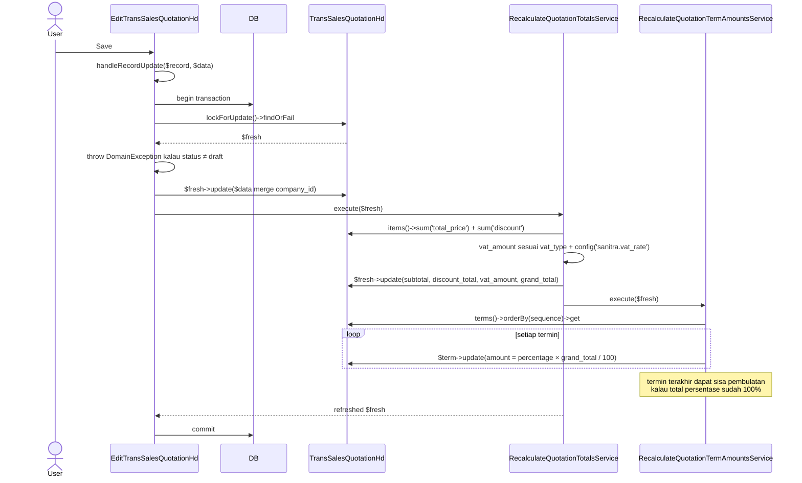
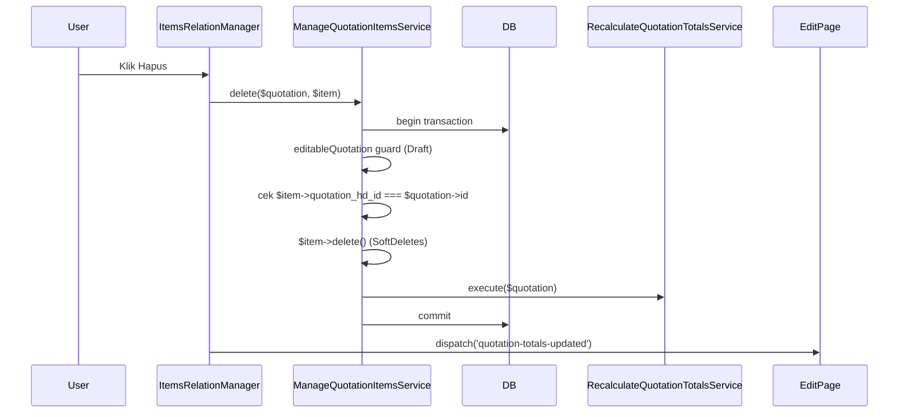
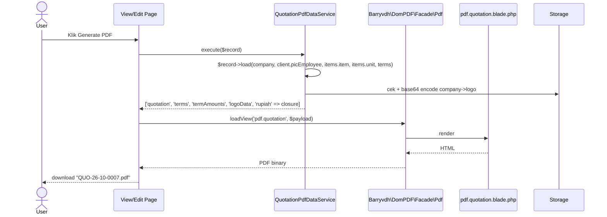
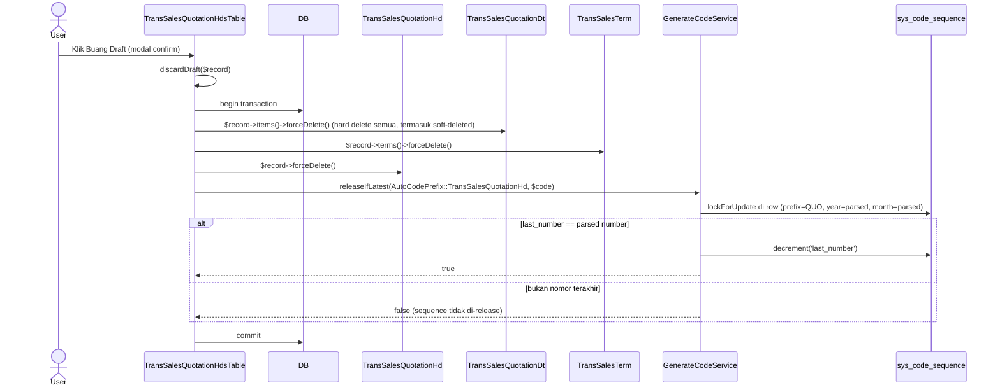
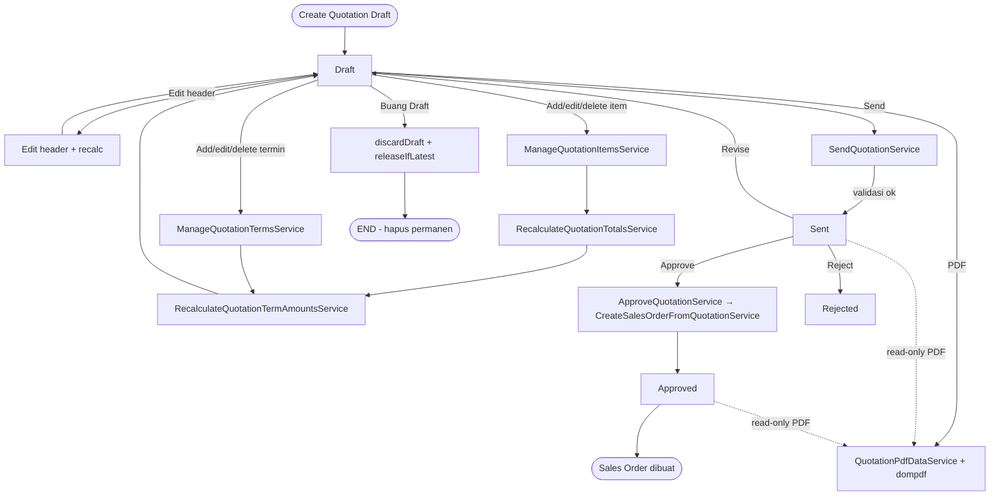

# Code Flow — Trans Sales Quotation

**Status:** Aktual, sinkron dengan code di `main` per 11 Okt 2026 · **Entitas:** `trans_sales_quotation_hd` + `trans_sales_quotation_dt` + `trans_sales_term` · **Acuan:** [bisnis-flow/quotation.md](../bisnis-flow/quotation.md), [implementation/quotation.md](../implementation/quotation.md), [architecture.md](../architecture.md)

Dokumen ini menjelaskan **cara kerja code** modul Quotation: file yang terlibat, urutan panggil service, batas DB transaction, dan sinkronisasi state Filament ↔ DB. Untuk aturan bisnis + status transisi, lihat [bisnis-flow/quotation.md](../bisnis-flow/quotation.md).

## 1. Peta Komponen

### 1.1 Model & Enum

| File | Peran |
| --- | --- |
| `app/Models/TransSalesQuotationHd.php` | Header; cast `vat_type` → `VatType`, nominal `decimal:6`, `transaction_date` `date`; relasi `items`, `terms`, `order`, `client`, `projectType`, `company`, `status` |
| `app/Models/TransSalesQuotationDt.php` | Detail item; cast `unit_price`/`discount`/`total_price` → `decimal:6` |
| `app/Models/TransSalesTerm.php` | Skema termin (shared dengan Sales Order via `order_hd_id` nullable) |
| `app/Enums/AutoCodePrefix.php` | Case `TransSalesQuotationHd = 'QUO'` |
| `app/Enums/Status/QuotationStatus.php` | `draft`, `sent`, `approved`, `rejected` + `color()` + `label()` |
| `app/Enums/VatType.php` | `none`, `include`, `exclude` + `label()` |

### 1.2 Service

Lokasi: `app/Services/Quotation/` (semua in `App\Services\Quotation`).

| File | Entry method | Fungsi |
| --- | --- | --- |
| `SendQuotationService.php` | `execute(TransSalesQuotationHd)` | Draft → Sent (validasi penuh) |
| `ApproveQuotationService.php` | `execute(TransSalesQuotationHd)` | Sent → Approved + trigger pembuatan SO |
| `RejectQuotationService.php` | `execute(TransSalesQuotationHd)` | Sent → Rejected |
| `ReviseQuotationService.php` | `execute(TransSalesQuotationHd)` | Sent → Draft (balik ke edit) |
| `RecalculateQuotationTotalsService.php` | `execute(TransSalesQuotationHd)` | Hitung ulang `subtotal`, `discount_total`, `vat_amount`, `grand_total`; delegasikan ke `RecalculateQuotationTermAmountsService` di akhir |
| `RecalculateQuotationTermAmountsService.php` | `execute(TransSalesQuotationHd): void` | Alokasikan `amount` ke tiap termin; sisa pembulatan jatuh ke termin terakhir kalau total persentase 100% |
| `ManageQuotationItemsService.php` | `save(hd, data, ?dt)` / `delete(hd, dt)` | CRUD item + validasi + hitung ulang |
| `ManageQuotationTermsService.php` | `save(hd, data, ?term)` / `delete(hd, term)` | CRUD termin + validasi + hitung ulang amount |
| `QuotationPdfDataService.php` | `execute(TransSalesQuotationHd): array` | Siapkan payload Blade `pdf.quotation` (logo base64, termin sorted, `rupiah` closure) |

Service lintas-domain yang dipanggil oleh `ApproveQuotationService`:

- `app/Services/SalesOrder/CreateSalesOrderFromQuotationService.php::execute(TransSalesQuotationHd): TransSalesOrderHd`
- `app/Services/Shared/GenerateCodeService.php::next(AutoCodePrefix): string` (dipakai di hampir semua service transaksi)

### 1.3 Filament Resource

Lokasi: `app/Filament/Resources/TransSalesQuotationHds/`.

| File | Peran |
| --- | --- |
| `TransSalesQuotationHdResource.php` | Resource utama; `canEdit`/`canDelete` hanya Draft; register 2 relation manager |
| `Pages/CreateTransSalesQuotationHd.php` | `mutateFormDataBeforeCreate` → generate code + default status/payment_type/vat/numerik 0; redirect ke Edit setelah create |
| `Pages/EditTransSalesQuotationHd.php` | `handleRecordUpdate` dalam `DB::transaction` + guard Draft + `RecalculateQuotationTotalsService`; header actions `generatePdf`; `#[On('quotation-totals-updated')]` → `refreshFormData` finansial |
| `Pages/ViewTransSalesQuotationHd.php` | Header actions: `send`, `approve`, `reject`, `revise`, `generatePdf`, `EditAction` (hanya Draft) |
| `Pages/ListTransSalesQuotationHds.php` | `CreateAction` + `ExportAction` (xlsx) |
| `Schemas/TransSalesQuotationHdForm.php` | Form schema (section Informasi + Ringkasan Keuangan); `project_type_id` reaktif → auto-fill `company_id` |
| `Schemas/TransSalesQuotationHdInfolist.php` | Infolist 3 section (Informasi Utama / Nominal / Audit) |
| `Tables/TransSalesQuotationHdsTable.php` | Columns + filter + `DeleteAction::make()->using(discardDraft)` + static `discardDraft()` yang hard-delete + release sequence |
| `RelationManagers/ItemsRelationManager.php` | CRUD item lewat `->using(fn => app(ManageQuotationItemsService::class)->save/delete)`; dispatch `quotation-totals-updated` setelah commit |
| `RelationManagers/TermsRelationManager.php` | CRUD termin lewat `ManageQuotationTermsService` |

### 1.4 PDF & Support

| File | Peran |
| --- | --- |
| `resources/views/pdf/quotation.blade.php` | Template dompdf (header + info + rincian item + termin) |
| `app/Filament/Forms/Components/MoneyInput.php` | Factory `TextInput` Rupiah (mask Alpine `$money` dengan strip suffix `.\d{6}`, `formatStateUsing`, `afterStateHydrated`) |
| `app/Support/Formatting/IndonesianMoneyFormatter.php` | `formatNumber/formatRupiah/formatInput/parseInput` |
| `config/sanitra.php` | `vat_rate` (dibaca `RecalculateQuotationTotalsService`) |

## 2. Alur `Create Quotation Draft`

Entry: user klik tombol **Create** di list page.

```mermaid
sequenceDiagram
    actor User
    participant Create as CreateTransSalesQuotationHd (Page)
    participant Code as GenerateCodeService
    participant Status as MsStatus
    participant Model as TransSalesQuotationHd
    participant Edit as EditTransSalesQuotationHd (Page)

    User->>Create: Submit form (project_type_id, client_id, vat_type, transaction_date)
    Create->>Create: mutateFormDataBeforeCreate(array $data)
    Create->>Code: next(AutoCodePrefix::TransSalesQuotationHd)
    Code-->>Create: "QUO/26/10/0007"
    Create->>Status: where(type=quotation, code=draft, active=1)->first
    Status-->>Create: $draftStatus
    Note over Create: $data['code'], payment_type='Termin',<br/>company_id dari project_type, status_id,<br/>vat_amount=0, discount_total=0, subtotal=0, grand_total=0
    Create->>Model: Model::create($data) (lewat Filament default)
    Model-->>Create: $record
    Create->>Edit: getRedirectUrl() → route Edit
    Edit-->>User: Form Edit Quotation
```

Catatan:

- `payment_type = 'Termin'` di-hardcode di hook; UI tidak lagi minta input.
- `vat_amount`/`discount_total`/`subtotal`/`grand_total` di-set `0` supaya kolom NOT NULL `decimal:6` aman. Nilai sebenarnya di-recalculate saat item/termin pertama ditambahkan.
- `company_id` disalin dari `MsProjectType::company_id` — form field disabled + dehydrated(false), tapi hook re-fetch dari relasi untuk konsistensi (sekaligus mencegah tampering client-side).

## 3. Alur `Edit Header` (saat Draft)

Entry: user ubah field di form Edit, submit.



Rumus VAT (dari `RecalculateQuotationTotalsService`):

- `none` → `vat_amount = 0`, `grand_total = subtotal`
- `include` → `vat_amount = subtotal × r / (1 + r)`, `grand_total = subtotal` (PPN sudah di dalam subtotal)
- `exclude` → `vat_amount = subtotal × r`, `grand_total = subtotal + vat_amount`

Semua pakai `bcmul`/`bcdiv`/`bcadd` presisi 6 — tidak ada float.

## 4. Alur `CRUD Item` lewat Relation Manager

Entry: `ItemsRelationManager` di halaman Edit/View.

### 4.1 Create / Edit

```mermaid
sequenceDiagram
    actor User
    participant RM as ItemsRelationManager
    participant Svc as ManageQuotationItemsService
    participant DB
    participant Model as TransSalesQuotationHd
    participant Recalc as RecalculateQuotationTotalsService
    participant Edit as EditTransSalesQuotationHd (parent)

    User->>RM: Submit form (item_id, unit_id, qty, unit_price, discount, notes)
    RM->>Svc: save($quotation, $data, ?$itemRecord)
    Svc->>Svc: Validator (item/unit exists, qty ≥ 1, discount ≥ 0, dst.)
    Svc->>DB: begin transaction
    Svc->>Model: lockForUpdate()->findOrFail (editableQuotation guard)
    Svc->>Svc: throw kalau status ≠ draft
    Svc->>Svc: cek MsItemUnit (item+unit) ada & active
    Svc->>Svc: bcmul(qty, unit_price); throw kalau discount > gross
    alt Create (item == null)
        Svc->>Model: $quotation->items()->create(attributes)
    else Edit
        Svc->>Model: $item->update(attributes)
    end
    Svc->>Recalc: execute($quotation)
    Recalc-->>Svc: hitung ulang + bind amount termin
    Svc->>DB: commit
    Svc-->>RM: $item
    RM->>Edit: dispatch('quotation-totals-updated') via Livewire
    Edit->>Edit: #[On] refreshQuotationTotals() → refreshFormData(discount_total, subtotal, vat_amount, grand_total)
    Edit-->>User: Form header ter-update
```

Validasi di `ManageQuotationItemsService::save`:

- `item_id`, `unit_id` wajib + exists di master.
- `qty ≥ 1`, `unit_price ≥ 0`, `discount` opsional (default `'0'`).
- Pair `(item_id, unit_id)` harus terdaftar di `MsItemUnit` dengan `active = true`.
- `discount ≤ qty × unit_price` (pakai `bccomp`).

### 4.2 Delete



Catatan: item dihapus pakai soft delete (`SoftDeletes` trait). Kalau quotation nanti **di-discard** lewat `discardDraft()`, item soft-deleted ikut `forceDelete()` juga.

## 5. Alur `CRUD Termin` lewat Relation Manager

Sama pola seperti item, tapi recalculate yang dipanggil berbeda:

- **Items change** → `RecalculateQuotationTotalsService` → delegasikan ke `RecalculateQuotationTermAmountsService`.
- **Terms change** → `RecalculateQuotationTermAmountsService` langsung (tanpa totals, karena nilai header tidak berubah).

Validasi di `ManageQuotationTermsService::save`:

- `term_name` ≤ 128 char.
- `percentage ∈ [1, 100]`, `progress_threshold ∈ [0, 100]`.
- Threshold 0 hanya boleh satu termin per quotation (DP unik).
- Total `percentage` seluruh termin tidak boleh > 100.
- Kalau `sequence` yang sama sudah dipakai termin soft-deleted → **restore** termin lama + update attribute + reset `status_id = draft` (prevents index collision + preserves history).

## 6. Alur `Send` (Draft → Sent)

Trigger: `send` action di View page.

```mermaid
sequenceDiagram
    actor User
    participant View as ViewTransSalesQuotationHd
    participant Svc as SendQuotationService
    participant DB
    participant Model as TransSalesQuotationHd
    participant Recalc as RecalculateQuotationTotalsService
    participant Status as MsStatus

    User->>View: Klik Kirim (requiresConfirmation)
    View->>Svc: execute($record)
    Svc->>DB: begin transaction
    Svc->>Model: lockForUpdate()->findOrFail
    Svc->>Svc: throw DomainException kalau status ≠ draft
    Svc->>Model: items()->exists; throw kalau kosong
    Svc->>Model: terms()->get; validasi total % = 100
    Svc->>Svc: throw kalau DP (threshold=0) count ≠ 1
    Svc->>Recalc: execute($quotation)
    Svc->>Status: get id (type=quotation, code=sent, active=1)
    Svc->>Model: $quotation->update(status_id = sent)
    Svc->>DB: commit
    Svc-->>View: $quotation refreshed
    View-->>User: notification "Quotation dikirim."
```

Guard di `SendQuotationService`:

1. `status->code === 'draft'`.
2. Minimal 1 item.
3. `terms.sum('percentage') === 100`.
4. Jumlah termin dengan `progress_threshold === 0` persis 1 (= tepat satu DP).

Recalculate dipanggil **sebelum** flip status supaya nilai `amount` termin final sebelum terkunci (termin yang berangkat ke SO memakai `amount` ini).

## 7. Alur `Approve` (Sent → Approved + buat SO)

**Transaksi paling kompleks** di modul Quotation. Dua service terlibat, dalam **satu** `DB::transaction`.

```mermaid
sequenceDiagram
    actor User
    participant View as ViewTransSalesQuotationHd
    participant Approve as ApproveQuotationService
    participant SO as CreateSalesOrderFromQuotationService
    participant Code as GenerateCodeService
    participant DB
    participant Q as TransSalesQuotationHd
    participant OHd as TransSalesOrderHd
    participant ODt as TransSalesOrderDt
    participant Term as TransSalesTerm
    participant Status as MsStatus

    User->>View: Klik Setujui (requiresConfirmation + modal)
    View->>Approve: execute($quotation)
    Approve->>DB: begin transaction
    Approve->>Q: lockForUpdate()->findOrFail
    Approve->>Approve: guard status === sent
    Note over Approve: SO dibuat SEBELUM flip status<br/>karena SO service guards status === sent
    Approve->>SO: execute($quotation)
    SO->>DB: begin savepoint (nested transaction)
    SO->>SO: guard status === sent + order()->exists
    SO->>SO: load items + terms; validate counts + sum % + 1 DP
    SO->>Code: next(AutoCodePrefix::TransSalesOrderHd)
    Code-->>SO: "SO/26/10/0003"
    SO->>Status: get id (order=waiting_dp, order_payment=unpaid)
    SO->>OHd: create (copy semua field finansial dari quotation)
    loop setiap item quotation
        SO->>ODt: create (quotation_dt_id pointer + salin field)
    end
    loop setiap termin quotation (sort by sequence)
        SO->>Term: update(order_hd_id, status_id = ready_to_bill jika threshold=0 else pending)
    end
    SO->>DB: commit savepoint
    SO-->>Approve: $order
    Approve->>Status: get id (quotation=approved)
    Approve->>Q: $quotation->update(status_id = approved)
    Approve->>DB: commit transaction
    Approve-->>View: $quotation refreshed
    View-->>User: notification "Quotation disetujui dan Sales Order dibuat."
```

Hal yang penting diingat:

- **Urutan**: SO dibuat **sebelum** status quotation flip ke `approved`. Alasannya: `CreateSalesOrderFromQuotationService` guard-nya cek `status === 'sent'`. Kalau quotation sudah `approved`, SO service akan reject.
- **Transaction nesting**: `ApproveQuotationService` membuka transaksi. `CreateSalesOrderFromQuotationService` juga membuka transaksi — Laravel otomatis bikin SAVEPOINT (bukan transaction baru), jadi semua akan rollback bareng kalau ada exception di mana saja.
- **Termin shared**: `trans_sales_term` baris tidak di-copy. Baris quotation yang sudah ada tinggal di-update `order_hd_id` + status. FK `trans_sales_term.quotation_hd_id` tetap jalan dan termin bisa diakses dari quotation (via `->terms`) atau SO (via `->terms`).
- **DP → `ready_to_bill` saat SO lahir**: BR-04. DP tidak menunggu progress project.

## 8. Alur `Reject` dan `Revise`

Keduanya simple, hanya ubah status:

- `RejectQuotationService::execute` → guard `status === sent` → update `status_id = rejected` dalam `DB::transaction` + `lockForUpdate`.
- `ReviseQuotationService::execute` → guard `status === sent` → update `status_id = draft`. Histori perubahan status tercatat lewat Spatie Activity Log (auto, karena `TransSalesQuotationHd` pakai trait log via `MasterTableColumns`/`AuditedBySoftDelete`).

Setelah Revise, user kembali ke mode edit; item/termin bisa diubah lagi.

## 9. Alur `Generate PDF`

Trigger: action `generatePdf` di View page atau Edit page (visible hanya saat `status === draft`).



Catatan:

- Logo di-inline base64 supaya dompdf tidak perlu akses filesystem (dompdf default `isRemoteEnabled=false`).
- `rupiah` closure dilempar sebagai variable Blade (`{{ $rupiah($item->unit_price) }}`), bukan via helper global.
- Nama file hasil download pakai `str_replace('/', '-', $code)` supaya aman di berbagai OS.

## 10. Alur `Discard Draft` + AutoCode Rollback

Trigger: `DeleteAction` di table (visible hanya saat Draft).



Perilaku `releaseIfLatest`:

- Parse `$code` → `parseCode` di `GenerateCodeService` baca pattern `QUO/YY/MM/NNNN` → ambil year/month/number.
- Cari `sys_code_sequence` row untuk `(QUO, year, month)` dengan `lockForUpdate`.
- Decrement hanya kalau `last_number === number dari code`. Mencegah tabrakan dengan record lain yang dibuat setelah draft ini (misal user ngedraft `0007` lalu bikin lagi `0008`, baru hapus `0007` → kode `0007` tidak dirilis).
- Return `false` kalau tidak di-release.

**Kenapa pakai `forceDelete`**: Draft adalah coretan. Soft delete akan menyisakan baris di DB dengan `code` yang unique. Kalau user discard dan mau create ulang di periode yang sama, `code` baru akan tabrakan dengan soft-deleted. `forceDelete` menghapus baris sepenuhnya; `releaseIfLatest` memungkinkan kode diterbitkan ulang untuk record berikutnya.

## 11. Sinkronisasi State Filament ↔ Service

Tiga titik sinkronisasi penting:

### 11.1 Reactive calculation di form row item

File: `ItemsRelationManager::updateTotal(Get $get, Set $set)`.

- `qty`, `unit_price`, `discount` pakai `->live()->afterStateUpdated(fn ... => self::updateTotal(...))`.
- `updateTotal` hitung `total_price` client-side (via `bcmul`/`bcsub` di PHP yang terpanggil tiap keystroke lewat Livewire) dan `Set` ke field `total_price`.
- **Nilai final yang disimpan** dihitung ulang di `ManageQuotationItemsService::save` dari `qty × unit_price - discount` dengan `bcmul`/`bcsub`. Preview client-side cuma UX; otoritas selalu di service.

### 11.2 Event `quotation-totals-updated` ↔ `#[On]`

- `ItemsRelationManager` memanggil `->after(fn (livewire) => $livewire->dispatch('quotation-totals-updated'))` setelah create/edit/delete sukses.
- `EditTransSalesQuotationHd::refreshQuotationTotals()` punya `#[On('quotation-totals-updated')]` attribute. Handler `refresh()` record + `refreshFormData(['discount_total', 'subtotal', 'vat_amount', 'grand_total'])` → form header re-render dengan nilai terbaru dari DB.
- Pola ini perlu karena recalculate terjadi di dalam service transaction yang tidak otomatis push ke form header.

### 11.3 Validasi: client-side vs service

| Rule | Client-side | Service-side |
| --- | --- | --- |
| `qty ≥ 1` | `->integer()->minValue(1)` di form | `Validator::make(..., ['qty' => 'integer', 'min:1'])` |
| `discount ≤ gross` | Tidak | `bccomp($discount, $gross, 6) > 0` throw |
| Unit terdaftar untuk item | `Select` option difilter dari `MsItemUnit` | `MsItemUnit::where(item+unit)->where(active)->exists()` throw |
| Status = Draft | Tombol/action `visible()` cek | `editableQuotation` guard throw `ValidationException` |

Hampir semua validasi di service. Form field constraint hanya untuk UX feedback cepat; service tetap authoritative (defense in depth).

## 12. Rangkuman Transaction Boundary

Setiap operasi yang mengubah DB berada dalam **satu** `DB::transaction`:

| Operasi | Transaction opens at | Commits/rolls back at |
| --- | --- | --- |
| Edit header | `EditTransSalesQuotationHd::handleRecordUpdate` | Idem |
| Add/edit/delete item | `ManageQuotationItemsService::save/delete` | Idem |
| Add/edit/delete termin | `ManageQuotationTermsService::save/delete` | Idem |
| Send | `SendQuotationService::execute` | Idem |
| Approve + buat SO | `ApproveQuotationService::execute` (SO service pakai SAVEPOINT nested) | Idem |
| Reject | `RejectQuotationService::execute` | Idem |
| Revise | `ReviseQuotationService::execute` | Idem |
| Discard Draft | `TransSalesQuotationHdsTable::discardDraft` | Idem |

`QuotationPdfDataService::execute` dan recalculate services **tidak** membuka transaksi sendiri — mereka dipanggil dari dalam transaksi yang sudah terbuka (atau untuk PDF, murni read + render).

Semua `lockForUpdate` dilakukan setelah transaction terbuka — mencegah race condition saat dua user edit quotation yang sama bersamaan.

## 13. Diagram Alur Lengkap (High-level)



## 14. Code Reading Order (buat orang baru)

Kalau mau baca code modul ini, urutan yang paling cepat paham:

1. `app/Enums/Status/QuotationStatus.php` — kosakata status.
2. `app/Models/TransSalesQuotationHd.php` + `Dt` + `TransSalesTerm` — struktur data.
3. `app/Services/Quotation/RecalculateQuotationTotalsService.php` + `RecalculateQuotationTermAmountsService.php` — jantung perhitungan.
4. `app/Services/Quotation/ManageQuotationItemsService.php` — pola `save/delete` + guard draft + recalc.
5. `app/Services/Quotation/SendQuotationService.php` + `ApproveQuotationService.php` → `app/Services/SalesOrder/CreateSalesOrderFromQuotationService.php` — transisi utama.
6. `app/Filament/Resources/TransSalesQuotationHds/Pages/EditTransSalesQuotationHd.php` + `ViewTransSalesQuotationHd.php` + `RelationManagers/*` — tempat service di-wire ke UI.
7. `resources/views/pdf/quotation.blade.php` + `QuotationPdfDataService.php` — PDF.

Semua service konsisten pakai pola: `DB::transaction` → `lockForUpdate` → guard status/relation → mutasi → return. Pola `->using(fn => app(Service::class)->method(...))` di relation manager + `app(Service::class)->execute($record)` di custom action adalah dua idiom standar yang perlu dikenali.
