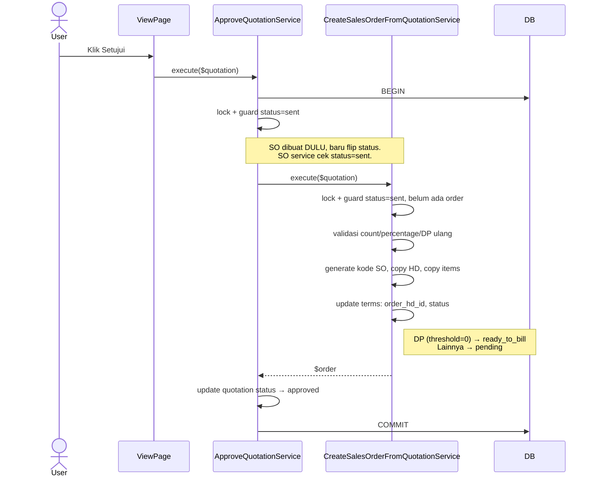
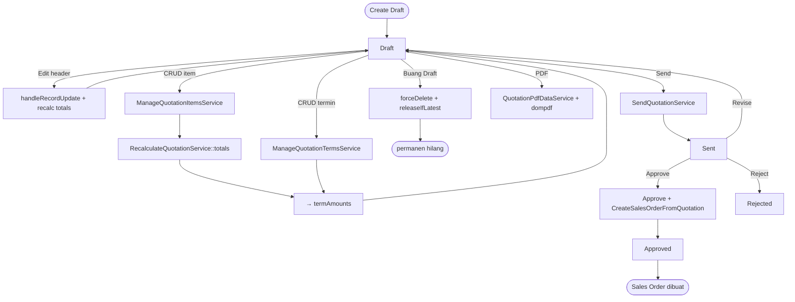

# Code Flow — Trans Sales Quotation

**Status:** Diperbarui 15 Okt 2026 · **Entitas:** `trans_sales_quotation_hd`, `trans_sales_quotation_dt`, `trans_sales_term` · **Acuan:** [bisnis-flow/quotation.md](../bisnis-flow/quotation.md), [implementation/quotation.md](../implementation/quotation.md)

Dokumen ini menjelaskan **cara kerja code** modul Quotation: urutan panggil, batas transaksi, dan sinkronisasi Filament ↔ DB. Untuk aturan bisnis + arti status, lihat [bisnis-flow/quotation.md](../bisnis-flow/quotation.md).

---

## 1. Model Mental 30 Detik

### Tiga lapisan

```
User ──▶ Filament Page ──▶ Service ──▶ Model/DB
         (UI + hook)       (logika)     (persist)
```

- **Filament page/relation manager** cuma menangkap input dan memanggil service.
- **Service** adalah satu-satunya tempat validasi + mutasi data terjadi.
- Setiap mutasi dibungkus `DB::transaction` dengan `lockForUpdate` di awal.

### Empat status quotation

```
Draft ──▶ Sent ──▶ Approved  (buat Sales Order)
             │
             ├──▶ Rejected
             └──▶ Draft  (Revise, balik ke edit)
```

Status disimpan di `ms_status` (type=`quotation`). Setelah Approved/Rejected, record terkunci.

### Daftar service terkait

| Service | Dipanggil saat |
|---------|----------------|
| `ManageQuotationItemsService` | CRUD item di relation manager |
| `ManageQuotationTermsService` | CRUD termin di relation manager |
| `RecalculateQuotationService` | Auto, setelah item/termin berubah |
| `QuotationReadinessService` | Cek kesiapan untuk Kirim dan Download PDF |
| `SendQuotationService` | Tombol **Kirim** (Draft → Sent) |
| `ApproveQuotationService` | Tombol **Setujui** (Sent → Approved + buat SO) |
| `RejectQuotationService` | Tombol **Tolak** (Sent → Rejected) |
| `ReviseQuotationService` | Tombol **Revisi** (Sent → Draft) |
| `QuotationPdfDataService` | Tombol **Generate PDF** |

Lintas-domain: `CreateSalesOrderFromQuotationService` (dipanggil dari `ApproveQuotationService`) dan `GenerateCodeService` (buat kode `QUO/YY/MM/XXXX`).

---

## 2. Golden Path (dari Create sampai Approve)

### 2.1 Create Draft

Entry: tombol **Create** di list page.

Alur di `CreateTransSalesQuotationHd::mutateFormDataBeforeCreate`:

1. User isi: `project_type_id`, `client_id`, `vat_type`, `transaction_date`.
2. Hook menambahkan:
   - `code` dari `GenerateCodeService::next(AutoCodePrefix::TransSalesQuotationHd)` → mis. `QUO/26/10/0007`.
   - `payment_type = 'Termin'` (hardcoded, bukan input user).
   - `company_id` di-fetch dari `MsProjectType->company_id` (anti-tampering).
   - `status_id` dari `ms_status` (quotation=`draft`).
   - Semua nilai uang di-set `0` supaya kolom `decimal:6` NOT NULL aman.
3. Filament default `Model::create($data)`.
4. Redirect ke halaman **Edit**.

> Angka `0` di nominal benar nanti saat item pertama ditambahkan — `RecalculateQuotationService::totals` yang hitung ulang.

### 2.2 Edit Header (saat Draft)

Entry: user ubah field di form Edit, klik Save.

Dalam `EditTransSalesQuotationHd::handleRecordUpdate`:

1. Buka `DB::transaction`.
2. `lockForUpdate` → cegah dua user edit bareng.
3. Guard: status harus `draft`, kalau bukan → `DomainException`.
4. `company_id` di-overwrite ulang dari `project_type_id` (field disabled di form bisa saja di-tamper).
5. `$record->update($data)`.
6. Panggil `RecalculateQuotationService::totals($record)` — lihat §4.1.
7. Commit.

### 2.3 CRUD Item (relation manager)

Entry: `ItemsRelationManager` memakai pola `->using(fn => app(Service::class)->save/delete(...))` sehingga semua action lewat service.

**Create / Edit** (`ManageQuotationItemsService::save`):

1. Validasi input dengan `Validator::make`:
   - `item_id`, `unit_id` exists di master.
   - `qty >= 1`, `unit_price >= 0`, `discount >= 0`.
2. Buka transaksi, lock quotation.
3. Guard: status harus `draft`.
4. Cek `(item_id, unit_id)` terdaftar di `MsItemUnit` dengan `active = true`.
5. Cek `discount <= qty × unit_price` (pakai `bccomp`).
6. Hitung `total_price = qty × unit_price − discount` (pakai `bcmul`/`bcsub`, bukan float).
7. `create()` atau `update()`.
8. Panggil `RecalculateQuotationService::totals($quotation)`.
9. Setelah commit, relation manager dispatch `quotation-totals-updated` untuk ringkasan finansial dan `refresh-page` untuk visibilitas action Kirim/PDF (lihat §4.2).

**Delete** (`ManageQuotationItemsService::delete`):

Lock + guard draft + `$item->delete()` (soft delete) + recalc. Sama polanya.

### 2.4 CRUD Termin (relation manager)

Beda dari item: recalc yang dipanggil adalah `RecalculateQuotationService::termAmounts` (bukan `totals`) karena nilai header tidak berubah.

Validasi tambahan di `ManageQuotationTermsService::save`:

- `percentage` 1–100, `progress_threshold` 0–100.
- **Threshold 0 hanya boleh satu** per quotation (DP unik, BR-15).
- Total `percentage` seluruh termin **tidak boleh > 100**.
- Edge case: kalau `sequence` yang sama pernah dipakai termin soft-deleted → **restore** baris lama (bukan create baru) untuk mencegah tabrakan unique index.
- Setelah create/edit/delete, relation manager dispatch `refresh-page` agar tombol Kirim/PDF dan pesan kesiapan ikut diperbarui.

### 2.5 Send (Draft → Sent)

Dalam `SendQuotationService::execute`:

1. Lock quotation, guard status `draft`.
2. Jalankan `QuotationReadinessService::ensureReady($quotation)`:

   | Validasi | Error |
   |----------|-------|
   | Minimal 1 item | "Quotation harus memiliki minimal satu item." |
   | `Σ percentage = 100` | "Total persentase termin harus 100%." |
   | Tepat 1 termin threshold 0 | "Quotation harus memiliki tepat satu termin DP dengan threshold 0%." |

3. **Recalc dulu, baru flip status** → `RecalculateQuotationService::totals` memastikan nilai `amount` termin final sebelum terkunci (dibawa ke SO).
4. Update `status_id` → `sent`.
5. Commit.

### 2.6 Approve (Sent → Approved + buat Sales Order)

**Operasi paling kompleks** — dua service dalam satu transaksi.



Hal yang mudah salah dipahami:

- **Urutan**: SO dibuat **sebelum** quotation jadi `approved`. Kalau quotation sudah `approved` duluan, SO service akan reject (guard-nya cek `sent`).
- **Transaksi nested**: `ApproveQuotationService` dan `CreateSalesOrderFromQuotationService` dua-duanya buka `DB::transaction`. Laravel otomatis bikin SAVEPOINT di call kedua — jadi semua rollback bareng kalau salah satu gagal.
- **Termin tidak di-copy**: baris termin tetap satu, cuma di-update `order_hd_id`. Akses dari quotation (`$q->terms`) atau SO (`$so->terms`) tetap jalan karena FK `quotation_hd_id` masih utuh.
- **DP langsung `ready_to_bill`** saat SO lahir — tidak perlu progress project.

### 2.7 Reject & Revise

Keduanya sederhana. Pola sama persis:

```
lock → guard status=sent → update status_id → commit
```

- `Reject`: status → `rejected` (terkunci).
- `Revise`: status → `draft` (user bisa edit lagi; histori perubahan tercatat otomatis via Spatie Activity Log).

---

## 3. Side Quests

### 3.1 Generate PDF

Tombol **Download PDF** di halaman View dan Edit hanya tampil saat `status = draft` dan `QuotationReadinessService::isReady($quotation)` bernilai benar. Tombol **Kirim Penawaran** di halaman View memakai syarat yang sama. Saat belum siap, subheading halaman View menampilkan syarat pertama yang belum terpenuhi.

Alur di `QuotationPdfDataService::execute`:

1. Panggil `QuotationReadinessService::ensureReady($quotation)` sebelum membuat respons unduhan. Guard ini juga berlaku saat action dipanggil langsung setelah data berubah.
2. Load relasi: `company`, `client.picEmployee`, `items.item`, `items.unit`, `terms`.
3. Baca file logo dari `Storage::disk('public')`, encode base64 (karena dompdf default `isRemoteEnabled = false`).
4. Return array berisi: `quotation`, `terms`, `termAmounts`, `logoData`, serta **closure** `angka` dan `rupiah` untuk format angka di Blade.
5. Action mengirim `Pdf::loadView('pdf.quotation', $payload)->output()` melalui `response()->streamDownload(...)` agar unduhan bekerja di Livewire.
6. Nama file: `str_replace('/', '-', $code).'.pdf'` → `QUO-26-10-0007.pdf`.

Service PDF **tidak** buka transaksi — murni read + render.

### 3.2 Buang Draft (Discard)

Tombol **Hapus** di tabel list visible hanya saat Draft. Pakai `discardDraft()` statik di `TransSalesQuotationHdsTable`:

1. Buka transaksi.
2. `forceDelete()` semua items + terms (termasuk yang sudah soft-deleted sebelumnya).
3. `forceDelete()` quotation header.
4. Panggil `GenerateCodeService::releaseIfLatest(AutoCodePrefix::TransSalesQuotationHd, $code)`:
   - Parse kode `QUO/YY/MM/NNNN`.
   - Lock baris `sys_code_sequence` untuk periode tersebut.
   - **Decrement hanya kalau `last_number === NNNN`** (nomor terakhir yang terbit).
   - Kalau sudah ada record lebih baru (mis. draft `0007` dihapus padahal `0008` sudah terbit), nomor tidak di-rollback.
5. Commit.

**Kenapa `forceDelete`?** Draft adalah coretan. Soft delete menyisakan baris dengan `code` unique — kalau user discard dan bikin lagi di bulan yang sama, kode baru tabrakan dengan baris soft-deleted. `forceDelete` menghilangkan baris sepenuhnya; `releaseIfLatest` memungkinkan kode diterbitkan ulang.

---

## 4. Konsep yang Perlu Diingat

### 4.1 Chain recalculate

`RecalculateQuotationService` punya dua method:

| Method | Hitung | Dipanggil saat |
|--------|--------|----------------|
| `totals($q)` | subtotal, discount_total, vat_amount, grand_total → **lalu panggil `termAmounts`** | item berubah, header di-edit, sebelum Send |
| `termAmounts($q)` | `amount` setiap termin dari persentase × grand_total | termin berubah |

**Rumus VAT** (presisi 6 pakai `bcmul`/`bcdiv`/`bcadd`, tidak ada float):

- `none` → `vat_amount = 0`, `grand_total = subtotal`
- `include` → `vat_amount = subtotal × r / (1 + r)`, `grand_total = subtotal`
- `exclude` → `vat_amount = subtotal × r`, `grand_total = subtotal + vat_amount`

Tarif `r` dibaca dari `config('sanitra.vat_rate')`. Kalau belum di-set tapi `vat_type ≠ none` → `DomainException`.

**Alokasi `amount` termin:**

- Umum: `amount = grand_total × percentage / 100`.
- Kalau total persentase sudah 100%: **termin terakhir** menerima sisa pembulatan supaya `Σ amount = grand_total` tepat.

### 4.2 Sinkronisasi UI ↔ DB

Dua lapis "perhitungan" yang gampang bikin bingung:

| Lapisan | Tujuan | Authoritative? |
|---------|--------|----------------|
| **Form (Alpine + Livewire)** | Preview real-time saat ketik `qty`/`unit_price`/`discount` | ❌ cuma UX |
| **Service (server)** | Hitung ulang & simpan saat submit | ✅ |

Yang bikin header form (subtotal, grand_total, dll.) **auto-refresh** setelah tambah item:

```
ItemsRelationManager::save()
  └── setelah commit, dispatch('quotation-totals-updated')
       └── EditTransSalesQuotationHd::refreshQuotationTotals()   (#[On])
            └── $this->record->refresh()
                 └── refreshFormData(['discount_total', 'subtotal', 'vat_amount', 'grand_total'])
```

Tanpa event ini, user harus reload halaman untuk lihat total yang baru.

`ItemsRelationManager` dan `TermsRelationManager` juga dispatch `refresh-page`. Halaman View menghitung ulang syarat kesiapan untuk menampilkan/menyembunyikan tombol Kirim/PDF; halaman Edit memperbarui visibilitas tombol PDF.

### 4.3 Validasi berlapis

Validasi penting selalu ada di **dua** tempat (defense in depth):

| Rule | Client (form) | Service |
|------|---------------|---------|
| `qty >= 1` | `->integer()->minValue(1)` | `Validator::make([..., 'min:1'])` |
| `discount <= gross` | — | `bccomp` throw |
| Unit terdaftar untuk item | `Select` option difilter | `MsItemUnit::where(...)->exists()` throw |
| Status = Draft | tombol `visible()` cek | `editableQuotation` guard throw |
| Kesiapan Kirim/PDF | tombol `visible()` cek syarat item dan termin | `QuotationReadinessService::ensureReady()` di service Send/PDF |

Form constraint cuma UX; service tetap yang authoritative.

---

## 5. Reference

### 5.1 Batas transaksi

Setiap operasi berikut dibungkus **satu** `DB::transaction`:

| Operasi | Dibuka di |
|---------|-----------|
| Edit header | `EditTransSalesQuotationHd::handleRecordUpdate` |
| CRUD item | `ManageQuotationItemsService::save` / `delete` |
| CRUD termin | `ManageQuotationTermsService::save` / `delete` |
| Send | `SendQuotationService::execute` |
| Approve + buat SO | `ApproveQuotationService::execute` (SO pakai SAVEPOINT nested) |
| Reject / Revise | masing-masing `::execute` |
| Buang Draft | `TransSalesQuotationHdsTable::discardDraft` |

`QuotationPdfDataService` dan `RecalculateQuotationService` **tidak** buka transaksi sendiri — mereka dipanggil dari dalam transaksi yang sudah terbuka (atau untuk PDF, murni read).

Semua `lockForUpdate` dilakukan **setelah** transaksi terbuka.

### 5.2 Peta file

**Model & Enum**

| File | Peran |
|------|-------|
| `app/Models/TransSalesQuotationHd.php` | Header; cast `vat_type` → `VatType`, nominal `decimal:6` |
| `app/Models/TransSalesQuotationDt.php` | Detail item |
| `app/Models/TransSalesTerm.php` | Termin (shared dengan SO via `order_hd_id` nullable) |
| `app/Enums/AutoCodePrefix.php` | Case `TransSalesQuotationHd = 'QUO'` |
| `app/Enums/Status/QuotationStatus.php` | `draft`/`sent`/`approved`/`rejected` + `color()`/`label()` |
| `app/Enums/VatType.php` | `none`/`include`/`exclude` |

**Service** (`app/Services/Quotation/`)

| File | Method |
|------|--------|
| `SendQuotationService.php` | `execute($q)` |
| `QuotationReadinessService.php` | `missingRequirement($q)`, `isReady($q)`, `ensureReady($q)` |
| `ApproveQuotationService.php` | `execute($q)` |
| `RejectQuotationService.php` | `execute($q)` |
| `ReviseQuotationService.php` | `execute($q)` |
| `RecalculateQuotationService.php` | `totals($q)`, `termAmounts($q)` |
| `ManageQuotationItemsService.php` | `save($q, $data, ?$item)`, `delete($q, $item)` |
| `ManageQuotationTermsService.php` | `save($q, $data, ?$term)`, `delete($q, $term)` |
| `QuotationPdfDataService.php` | `execute($q): array` |

**Filament** (`app/Filament/Resources/TransSalesQuotationHds/`)

| File | Peran |
|------|-------|
| `TransSalesQuotationHdResource.php` | Resource utama; `canEdit`/`canDelete` hanya Draft |
| `Pages/CreateTransSalesQuotationHd.php` | `mutateFormDataBeforeCreate` → kode + default status/vat/0 |
| `Pages/EditTransSalesQuotationHd.php` | `handleRecordUpdate` + recalc + `#[On('quotation-totals-updated')]`; PDF hanya saat siap |
| `Pages/ViewTransSalesQuotationHd.php` | Header actions: Kirim/Download PDF hanya saat siap; tampilkan syarat yang belum terpenuhi |
| `Pages/ListTransSalesQuotationHds.php` | `CreateAction` + `ExportAction` xlsx |
| `Schemas/TransSalesQuotationHdForm.php` | Form schema; `project_type_id` reaktif auto-fill `company_id` |
| `Schemas/TransSalesQuotationHdInfolist.php` | 3 section: Informasi / Nominal / Audit |
| `Tables/TransSalesQuotationHdsTable.php` | Columns + filter + `discardDraft` + release sequence |
| `RelationManagers/ItemsRelationManager.php` | CRUD item via service + dispatch event ringkasan dan refresh halaman |
| `RelationManagers/TermsRelationManager.php` | CRUD termin via service + dispatch refresh halaman |

**PDF & Support**

| File | Peran |
|------|-------|
| `resources/views/pdf/quotation.blade.php` | Template dompdf |
| `app/Filament/Forms/Components/MoneyInput.php` | Factory TextInput Rupiah (mask Alpine `$money`) |
| `app/Support/Formatting/IndonesianMoneyFormatter.php` | `formatRupiah`, `parseInput`, dll. |
| `config/sanitra.php` | `vat_rate` |

### 5.3 Diagram alur lengkap



---

## 6. Urutan Baca untuk Orang Baru

Kalau mau cepat paham, baca dengan urutan ini (bukan urutan folder):

1. `app/Enums/Status/QuotationStatus.php` — kosakata status.
2. `app/Models/TransSalesQuotationHd.php` + `Dt` + `TransSalesTerm` — struktur data.
3. `app/Services/Quotation/RecalculateQuotationService.php` — jantung perhitungan.
4. `app/Services/Quotation/ManageQuotationItemsService.php` — pola `save/delete` + guard + recalc.
5. `SendQuotationService.php` → `ApproveQuotationService.php` → `app/Services/SalesOrder/CreateSalesOrderFromQuotationService.php` — transisi utama.
6. `app/Filament/Resources/TransSalesQuotationHds/Pages/EditTransSalesQuotationHd.php` + `ViewTransSalesQuotationHd.php` + `RelationManagers/*` — tempat service di-wire ke UI.
7. `resources/views/pdf/quotation.blade.php` + `QuotationPdfDataService.php` — PDF.

Dua idiom yang berulang di semua service transaksi di repo ini:

- Di relation manager: `->using(fn => app(Service::class)->method(...))`.
- Di custom action: `app(Service::class)->execute($record)`.

Semuanya pakai pola: `DB::transaction` → `lockForUpdate` → guard → mutasi → return.
